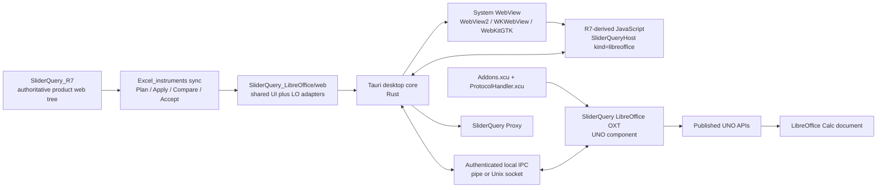
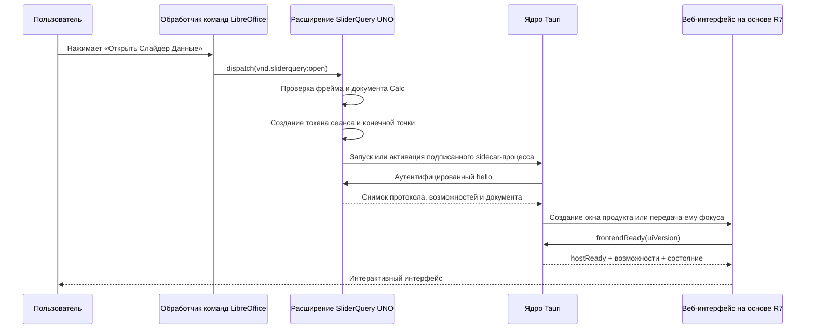

# Рынок плагинов для LibreOffice с совместимостью с плагинами ONLYOFFICE

**Архитектура, требования и ревью. SliderQuery как первый плагин платформы**

**Статус документа:** проект целевой архитектуры после второго ревью; требует решения руководства (Часть I, раздел I.6)  
**Дата ревью:** 2026-11-26  
**Ветка:** `lo-plugins` (снимок `LibreOffice/core`, ветка `master`)  
**Исходные проекты:** `SliderQuery_R7` (эталонный веб-продукт), `SliderQuery_Excel` (эталонный хост VSTO), `SliderQuery_LibreOffice` (целевой), `Excel_instruments` (миграция, сборка, тесты)

### Как читать документ

| Часть | Для кого | Содержание |
|---|---|---|
| **Часть I. Аналитическая записка** | Руководство | Цели, варианты, цена, жертвы, риски, решения, которые нужно принять |
| **Часть II. Архитектура** | Архитекторы, технические лидеры | Целевая архитектура, ключевые решения (ADR), результаты ревью, риски, открытые вопросы |
| **Приложение 1** | Архитекторы, разработчики, QA | Нормативные требования к рынку плагинов и совместимости с ONLYOFFICE (идентификаторы `OO-*`) |
| **Приложение 2** | Разработчики SliderQuery | Исходная спецификация хоста SliderQuery для LibreOffice (sidecar-процесс, IPC, Calc) — в переводе, с пометками, что изменилось |
| **Приложение 3** | Все | Источники |

Если Часть II и Приложение 2 противоречат друг другу, действует Часть II и Приложение 1. Приложение 2 остаётся в силе для интеграции SliderQuery в той мере, в какой оно не противоречит им.

---

## Часть I. Аналитическая записка для руководства

### I.1 Суть в одном абзаце

Мы предлагаем сделать для LibreOffice **магазин плагинов**, в котором работают **без переделки** плагины, написанные для редакторов ONLYOFFICE (и, по всей видимости, для совместимых с ними продуктов, включая Р7-Офис — это нужно подтвердить). Собственный продукт **«Слайдер Данные» (SliderQuery)** становится первым плагином этой платформы. Технически это достижимо, но только в **собственной сборке LibreOffice**, а не в виде обычного расширения. Это долгий проект (оценочно 1,5–2,5 года до заявленного уровня совместимости) с постоянными расходами на сопровождение. Решение о варианте нужно принять до начала основной разработки.

### I.2 Цели

1. **Экосистема для пользователей LibreOffice.** Дать готовый каталог расширений с привычным для веб-разработчиков способом их писать (HTML/JavaScript), которого в LibreOffice сегодня нет.
2. **Переиспользование чужих и своих плагинов.** Плагины ONLYOFFICE (в официальном каталоге 62 штуки, плюс корпоративные плагины заказчиков) запускаются в LibreOffice без переписывания. Разработчик пишет плагин один раз — он работает в ONLYOFFICE и в нашем LibreOffice.
3. **Единая платформа для собственных продуктов.** SliderQuery и будущие продукты работают в Writer, Calc и Impress на Windows, Linux и macOS одним кодом, без отдельной ветки под каждый офисный пакет.
4. **Снижение зависимости от одного поставщика редактора.** Заказчик, вложившийся в плагины под ONLYOFFICE, получает альтернативную платформу.

**Предлагаемые показатели успеха (KPI):**

| Показатель | Цель первого выпуска рынка |
|---|---|
| Доля плагинов эталонного набора, работающих полностью | ≥ 95% от не исключённых по замыслу |
| Плагины, «тихо» не работающие | 0 (каждый классифицирован и помечен в магазине) |
| Сбои LibreOffice по вине плагина | 0 на тестовом наборе (плагин падает отдельно) |
| SliderQuery: ключевые сценарии (подключения, запросы, вывод в Calc) | Паритет с версией для Excel |
| Время открытия плагина-панели | ≤ 1,5 с |

### I.3 Варианты

| Вариант | Что это | Совместимость с плагинами ONLYOFFICE | Пользовательский опыт | Стоимость и сроки | Главный риск |
|---|---|---|---|---|---|
| **А. Расширение для обычного LibreOffice** (исходное предложение) | Плагины в отдельном окне рядом с LibreOffice | Низкая: нет встроенных панелей и модальных окон; команды плагинов медленные и ненадёжные | Слабый, особенно в Linux (Wayland) | Наименьшие | Не решает задачу рынка плагинов |
| **А+. Нативное расширение внутри процесса** (выявлено анализом рисков, раздел II.10.1) | Расширение на C++ со встроенным браузером в боковой панели и движком команд, без собственной сборки | Высокая, кроме native Wayland, динамических вкладок ленты и части форматов | Близкий к ONLYOFFICE; в Linux — через XWayland | Средние | Ограничения опубликованного API; не проверено прототипом |
| **Б. Собственная сборка LibreOffice** | Встроенные панели, движок команд внутри LibreOffice | Высокая | Как в ONLYOFFICE | Высокие + постоянное сопровождение сборки | Стоимость поддержки собственной сборки |
| **В. Б, переданный в основной проект LibreOffice** | То же, но принято сообществом | Высокая | Как в ONLYOFFICE | Как Б, плюс работа с сообществом; сопровождение со временем снижается | Сообщество может не принять встроенный браузер |
| **Г. Перенос топ-N плагинов вручную** | Без слоя совместимости: нужные плагины переписываются под LibreOffice | Только перенесённые плагины | Хороший для перенесённых | Низкие на старте, растут с каждым плагином | Нет рынка: каждый плагин — отдельный проект |

**Рекомендация:** вариант **Б, организованный так, чтобы его можно было передать в основной проект (В)**. **Но сначала** нужно проверить вариант **А+** прототипом (2–4 недели): если он подтвердится, собственная сборка сведётся к небольшому набору доработок ядра, а главная статья постоянных расходов резко уменьшится (Часть II, раздел II.10). Вариант А оставить только как запасной путь для SliderQuery. Вариант Г использовать как тактику для 2–3 приоритетных плагинов, пока слой совместимости не готов.

### I.4 Цена: что придётся отдать (жертвы)

1. **Собственная сборка LibreOffice.** Мы перестаём быть «расширением» и становимся поставщиком офисного пакета. LibreOffice выпускает крупную версию раз в полгода и исправления безопасности чаще. Каждый выпуск нужно переносить в нашу сборку, тестировать и распространять. Оценка — **постоянно 3–5 инженеров** только на сопровождение сборки и отслеживание изменений API ONLYOFFICE.
2. **Сроки.** До заявленного уровня совместимости (≥ 95% плагинов) — **оценочно 18–30 месяцев** командой **10–15 инженеров**, из них значительная часть — разработчики C++ с опытом в кодовой базе LibreOffice (дефицитная компетенция). Первые работающие плагины — через 6–9 месяцев. *Это экспертная оценка до технических прототипов; уточняется по итогам этапа 1.*
3. **Не 100% плагинов.** Плагины, завязанные на облако или настольное приложение ONLYOFFICE (шифрование, совместное редактирование, внутренние плагины), в LibreOffice работать не будут. Около 5–10% каталога будут помечены как неподдерживаемые.
4. **Размер дистрибутива.** Для совместимости нужен браузерный движок класса Chromium: **+150–200 МБ** к установщику на каждой платформе и обязанность оперативно выпускать его обновления безопасности.
5. **Юридические ограничения.** Код ONLYOFFICE распространяется под AGPL-3.0, LibreOffice — под MPL-2.0. Мы **не можем копировать** код ONLYOFFICE: всё пишется с нуля по публичной документации (так называемая «чистая комната»). Название ONLYOFFICE — товарный знак: можно писать «совместим с плагинами ONLYOFFICE», нельзя использовать их бренд.
6. **Поверхность атаки.** Код сторонних плагинов будет менять документы пользователей внутри процесса LibreOffice. Нужны песочница, проверка, подписи, отзыв плагинов и корпоративные политики. Это отдельная постоянная функция (безопасность и модерация каталога).
7. **Подвижная цель.** ONLYOFFICE выпускает 3–4 версии в год и расширяет API (за 8.1 → 10.0 добавились пользовательские функции, асинхронные вызовы, новый способ вызова методов). Совместимость фиксируется на определённой версии API и требует постоянного отслеживания. ONLYOFFICE может намеренно изменить протокол.
8. **Ценность каталога для целевого рынка.** Многие плагины каталога — обёртки над внешними облачными сервисами (ИИ, переводчики, видео, менеджеры библиографии). Если целевой рынок — Россия, часть этих сервисов недоступна или их использование ограничено. Ценность «всех плагинов» для такого рынка нужно проверить; возможно, важнее корпоративные плагины и каталог совместимых российских продуктов.

### I.5 Главные риски

| Риск | Вероятность | Влияние | Как снижаем |
|---|---|---|---|
| Стоимость сопровождения собственной сборки выше плана | Высокая | Высокое | Минимальные, изолированные изменения; ранний контакт с сообществом LibreOffice (вариант В) |
| Встроить браузер в LibreOffice на Linux (Wayland) сложнее, чем ожидается | Средняя | Высокое | Технический прототип на всех ОС до начала основной разработки |
| Объём API ONLYOFFICE (тысячи методов) недооценён | Высокая | Высокое | Реализуем сначала методы, которые реально вызывают плагины каталога; полное покрытие — не цель первого выпуска |
| Юридические претензии (лицензия, товарный знак) | Средняя | Высокое | Юридическая экспертиза до старта; документированный процесс «чистой комнаты» |
| Нехватка разработчиков C++ для LibreOffice | Высокая | Среднее | Найм или привлечение подрядчиков с опытом в LibreOffice |
| Низкая востребованность каталога у целевых заказчиков | Средняя | Высокое | Проверить спрос: опрос заказчиков, список нужных плагинов до этапа 3 |

### I.6 Решения, которые нужны от руководства

1. **Выбор варианта** (рекомендован Б с ориентацией на В) и согласие с постоянными расходами на собственную сборку.
2. **Бюджет и команда** на этапы 0–1 (3–4 месяца, 4–6 инженеров), после которых оценка уточняется и принимается решение о продолжении.
3. **Юридическая экспертиза** лицензий (AGPL/MPL), товарного знака и процесса «чистой комнаты».
4. **Целевой рынок и платформы**: страны, операционные системы, минимальные версии; это меняет ценность каталога и объём тестирования.
5. **Стратегия магазина**: только официальный каталог ONLYOFFICE, собственный курируемый каталог или оба; кто отвечает за модерацию и поддержку.
6. **Согласие на KPI** из раздела I.2 как критерии выпуска.

### I.7 Этапы и точки принятия решений

| Этап | Длительность (оценка) | Результат | Решение по итогам |
|---|---|---|---|
| 0. Решение и подготовка | 1 мес. | Юридическое заключение, контакт с сообществом LibreOffice, план прототипов (II.10.4) | Старт прототипов |
| 1. Технические прототипы | 2–3 мес. | Прототипы П-1…П-7 (II.10.4): вариант «А+», браузер во встроенной панели на трёх ОС, движок команд с ограничением времени, контекстное меню, пользовательские функции, сохранение объектов плагинов | **Выбор варианта (А+ / Б / В); продолжать / остановиться / перейти на вариант Г** |
| 2. Протокол и среда выполнения | 3–4 мес. | Работают простые плагины-примеры | — |
| 3. Writer | 3–5 мес. | 20 плагинов только для текстовых документов работают полностью или частично | Подтверждение графика |
| 4. Calc и Impress, пользовательские функции, объекты плагинов | 4–6 мес. | Основной каталог работает | — |
| 5. Магазин | 2–3 мес. (параллельно) | Каталоги, подписи, политики, обновления | — |
| 6. PDF, длинный хвост API | 4–8 мес. | ≥ 95% плагинов работают полностью | **Первый выпуск рынка** |

SliderQuery (первый плагин) может выйти раньше рынка — после этапа 4 — потому что ему нужен ограниченный набор возможностей Calc.

---

## Часть II. Архитектура (для архитекторов)

### II.1 Контекст: от одного приложения к платформе

Исходный документ (Приложение 2) проектировал **одно доверенное приложение** — SliderQuery — для **Calc** в виде расширения для **обычного** LibreOffice. Отсюда все его ключевые решения: отдельное окно sidecar-процесса на Tauri, тонкий OXT, права только для собственного кода из поставки, запрет удалённых страниц.

Новая цель другая: **платформа для сторонних плагинов** во **всех** редакторах (Writer, Calc, Impress, Draw/PDF), совместимая с плагинами ONLYOFFICE **без их изменения**. Это меняет:

- модель доверия: сторонний, часто удалённо загружаемый код вместо собственного;
- модель интерфейса: встроенные панели, модальные окна, меню, подсказки у курсора вместо отдельного окна;
- модель выполнения: синхронные команды над объектной моделью документа (`callCommand`) вместо асинхронных типизированных вызовов;
- объём: тысячи методов API трёх редакторов вместо нескольких десятков операций Calc;
- способ поставки: собственная сборка LibreOffice вместо расширения.

SliderQuery остаётся важнейшим потребителем и становится **первым плагином** платформы с дополнительными подписанными возможностями (Proxy, большие данные).

### II.2 Ключевое решение: способ поставки (ADR-001)

Исходная предпосылка (Приложение 2, §П2.3, §П2.4.4) — «в обычном LibreOffice нет опубликованного API для встраивания браузера, поэтому нельзя трогать внутренности VCL» — верна только для расширения. Работа ведётся в исходниках **LibreOffice core** (ветка `lo-plugins`), значит:

- браузер во встроенной панели — это наш собственный код. Например: WebView2 в `SystemChildWindow` (HWND) на Windows, `WKWebView` в `NSView` на macOS, WebKitGTK в VCL-плагинах gtk3/gtk4, QtWebEngine в qt5/qt6/kf. Либо **один движок (CEF) на всех платформах** — см. ADR-003;
- движок JavaScript внутри процесса уже есть: в `master` присутствует экспериментальная поддержка **QuickJS с привязкой к UNO** (`jsuno/`, поставщик скриптов `jsprov` в `scripting/`, ключ сборки `--enable-quickjs`). Это ровно то, что нужно для `callCommand`.

| Вариант | Встраивание | Движок команд | Стоимость и риск |
|---|---|---|---|
| А. Расширение для обычного LibreOffice | Только отдельное окно | JS вне процесса, синхронный IPC на каждый вызов API | Минимальное сопровождение; слабый UX; медленный и хрупкий `callCommand` |
| Б. Собственная сборка LibreOffice | Встроенные панели | QuickJS внутри процесса на потоке офиса | Лучшая совместимость и UX; перенос изменений на каждый выпуск LibreOffice; ответственность за безопасность всего пакета |
| В. Б, принятый в основной проект | Опубликованный UNO-сервис веб-панели + хост плагинов | QuickJS внутри процесса | Лучший в долгосрочной перспективе; нужна поддержка сообщества и код только под MPL, написанный с нуля |

**Решение (предлагаемое):** **Б как способ поставки, устроенный как В.** Изменения держать небольшими, за опубликованными UNO-интерфейсами, под MPL-2.0, и предлагать в основной проект. Вариант А не удовлетворяет Приложению 1 (панели, модальность, синхронный `callCommand`, Writer/Impress) и остаётся запасным путём только для SliderQuery.

### II.3 Целевая архитектура

```text
LibreOffice (собственная сборка, ветка lo-plugins)
├── Plugin Host Service (C++, UNO-сервис, sfx2/framework)
│   ├── Package Manager — установка/обновление/удаление; новый тип пакета
│   │   в существующей подсистеме развёртывания (desktop/source/deployment)
│   ├── Catalog & Policy — каталоги, подписи, отзыв, политики через officecfg
│   ├── UI Bridge — боковые панели (Sidebar decks), диалоги, вкладка «Плагины»,
│   │   контекстное меню, панели инструментов, подсказки у курсора
│   ├── Protocol Adapter — сторона редактора протокола postMessage ONLYOFFICE
│   │   + внедряемая среда выполнения плагина (собственная, написанная с нуля)
│   └── Event Router — события документа → события плагинов (с объединением)
├── Web Runtime (CEF или системный WebView; ADR-003)
│   └── отдельный процесс отрисовки и отдельный origin на каждый плагин
├── Command Engine (QuickJS + jsuno, песочница, сторожевой таймер)
│   └── Api Layer: объектная модель ONLYOFFICE поверх UNO
│       ├── Writer (sw)  ├── Calc (sc)  ├── Impress (sd)  └── PDF/Draw (частично)
├── Document Interop — фильтры oox/xmloff: объекты плагинов, поля ADDIN,
│   элементы управления содержимым, макросы JS, пользовательские функции
└── Calc Add-in Bridge — пользовательские функции JS как функции Calc

SliderQuery (первый плагин)
├── веб-интерфейс R7 как плагин-панель (тот же веб-код)
└── опционально: локальная служба для Proxy и больших данных
    (бывший Rust-core из Приложения 2; правила IPC, разбиения на блоки
    и обратного давления из §П2.11, §П2.12, §П2.22 сохраняются)
```

Поток вызова команды плагина:

```text
плагин (процесс отрисовки, свой origin)
  Asc.plugin.callCommand(fn)
      │ postMessage {type:"command", data:"<строка кода>"}
      ▼
Protocol Adapter (проверка источника, схемы, размера)
      │ постановка в очередь сериализованного диспетчера офиса
      ▼
Command Engine: QuickJS-контекст плагина
  enterUndoContext → lockControllers → выполнить код над Api
  → unlockControllers → leaveUndoContext → пересчёт (если isCalc)
      │ результат (только JSON) / ошибка / прерывание по таймеру
      ▼
плагин: onCommandCallback
```

### II.4 Что сохраняем из исходного проекта

Эти решения Приложения 2 верны и переносятся в хост плагинов без изменений:

- аутентифицированный, проверяемый по схеме, версионированный IPC с ограничениями кадров и очередей (§П2.11) — для связи с внешними службами вроде SliderQuery Proxy;
- идентичность документа, выдаваемая хостом, с поколениями, а не по заголовку или пути (§П2.15);
- сериализованный диспетчер UNO на стороне офиса, ограниченные очереди, запись блоками, парность `lockControllers` и контекстов отмены (§П2.16–П2.17);
- кооперативная отмена и отбрасывание устаревших ответов (§П2.12.5);
- согласование возможностей вместо ветвлений по имени хоста (§П2.13.4, §П2.27.1);
- правило «никаких универсальных лазеек» (§П2.14.3) — для сторонних плагинов оно становится ещё важнее;
- матрицы тестов с внедрением сбоев и на реальном офисе (§П2.28).

### II.5 Замечания к исходному проекту (первое ревью)

1. **Одно приложение — не рынок.** Модель безопасности (§П2.8, §П2.24.2) даёт права только собственным ресурсам из поставки и запрещает удалённые страницы и навигацию. Рынку нужны изоляция плагинов, отдельное хранилище на плагин, согласие при установке, доверие к каталогу, подписи и отзыв, корпоративные списки разрешений и запретов, каналы обновлений, изоляция сбоев и зависаний, раскрытие передачи данных наружу. Всё это — в §П1.11–§П1.13.
2. **Отдельное окно не подходит для типов плагинов ONLYOFFICE.** В Wayland клиент не может расположить своё окно относительно окна другого приложения, поэтому «окно рядом с Calc, следующее за активным документом» (§П2.4.2) там нереализуемо. Модальность между процессами ненадёжна: пользователь может править документ, пока плагин считает его заблокированным. Подсказкам у курсора нужны экранные координаты каретки и всплывающее окно, принадлежащее окну документа. Фокус и горячие клавиши (Esc, Ctrl+Z) между процессами ломаются.
3. **Только Calc.** Плагины ONLYOFFICE работают с `word`, `cell`, `slide` и `pdf`. Реестр, события, коды ошибок, хранение метаданных (скрытый лист) и тесты в Приложении 2 привязаны к Calc.
4. **`callCommand` несовместим с моделью «всё вне процесса».** Тело команды выполняется синхронно над объектной моделью; через sidecar-процесс каждое обращение к свойству — блокирующий обмен по IPC, цикл по 10 000 ячейкам — более 10 000 обменов и секунды задержки, а частичный сбой оставляет недоделанные правки. Поэтому команды выполняются внутри процесса. Правило «JavaScript не получает сырых объектов UNO» (§П2.34, правило 4) сохраняется в новой форме: песочнице доступны только `Api`, `Asc.scope` и стандартные встроенные объекты ECMAScript.
5. **Движок браузера определяет совместимость.** Tauri использует три разных движка. Плагины ONLYOFFICE разрабатываются под Chromium (настольные редакторы ONLYOFFICE встраивают CEF; по умолчанию ветка 5414, примерно Chromium 109). Некоторые плагины требуют API только Chromium (например, `webkitSpeechRecognition`).
6. **Взаимодействие с документами не решено.** Плагины сохраняют в документах объекты (данные + картинка + GUID плагина), элементы управления содержимым, комментарии, поля, JS-макросы и пользовательские функции. Хранение метаданных в Приложении 2 (§П2.19.2) годится только для Calc и SliderQuery.
7. **Пользовательские функции JavaScript и многопоточный пересчёт Calc.** Функция JS должна регистрироваться как функция надстройки Calc и не выполняться параллельно в одном контексте.
8. **Python как MVP** (§П2.9.4) не нужен в варианте Б/В: хост пишется на C++ внутри процесса. В Linux-дистрибутивах поставщик Python-скриптов — отдельный пакет. Python допустим только для прототипов работы с данными Calc.
9. **Несколько экземпляров LibreOffice** (§П2.10.3): один профиль пользователя допускает один запущенный экземпляр; это частный случай, а не движущая сила архитектуры.
10. **Бюджеты производительности** (§П2.22.4) покрывают только запись диапазонов. Нужны также холодный старт плагина, задержка `callCommand`, память на плагин (процесс отрисовки — порядка 50–150 МБ) и ограничение числа одновременно работающих плагинов.
11. **Лицензии.** `sdkjs` и репозиторий каталога `onlyoffice.github.io` (включая `v1/plugins.js` и плагины каталога) — AGPL-3.0; только репозиторий примеров `sdkjs-plugins` — Apache-2.0. Код хоста, внедряемой среды и `Api` пишется с нуля по документации. Название ONLYOFFICE — товарный знак Ascensio System SIA.
12. **Совместное редактирование и внутренние механизмы ONLYOFFICE** (чат, присутствие, `AscDesktopEditor`, шифрование) не имеют аналогов; такие плагины классифицируются, а не ломаются молча.

### II.6 Замечания второго ревью

Второе ревью проверяло и исходный документ, и добавленные в первом ревью требования.

1. **У документа не было ясной идентичности.** Заголовок «SliderQuery LibreOffice Host Architecture» и выводы разделов 2–4 противоречили новым требованиям. Исправлено: документ переименован, целевая архитектура вынесена в Часть II, исходная спецификация — в Приложение 2 с явным правилом приоритета.
2. **Не было экономического обоснования.** Ни оценки затрат, ни показателей успеха, ни альтернатив для руководства. Добавлено в Часть I. Оценки — экспертные, уточняются после этапа 1.
3. **Не рассмотрена альтернатива «перенос топ-N плагинов»** (вариант Г). Она дешевле на старте и полезна как тактика, но не создаёт рынок. Добавлено в I.3.
4. **Требование «весь документированный API» (OO-API-3) завышено для первого выпуска.** По документации это порядка 300 классов и ~8 000 страниц методов с большим пересечением между редакторами (оценка ±15%). Реалистичная цель первого выпуска — **методы, которые реально вызывают плагины эталонного набора** (определяются статическим и динамическим трассированием), плюс общее ядро. Полное покрытие — цель последующих выпусков. Требование уточнено в §П1.7: полный охват из обязательного стал целевым.
5. **Встраивание браузера на Linux — главный технический риск.** Межпроцессное встраивание окна (reparenting) в Wayland невозможно (нет XEmbed). Оконный режим CEF под Wayland ограничен; внеэкранная отрисовка CEF (OSR) работает везде, но усложняет ввод (IME), специальные возможности и стоит производительности. Решение (ADR-003) принимается только по итогам прототипа на gtk3, gtk4, qt6 под X11 и Wayland.
6. **Процессная модель CEF внутри `soffice`.** Процессы отрисовки CEF отдельные, но процесс браузера CEF живёт внутри процесса LibreOffice; сбой процесса браузера или GPU может затронуть офис. Нужно проверить в прототипе и предусмотреть перезапуск.
7. **Безопасность движка команд внутри процесса.** Код сторонних плагинов исполняется в QuickJS внутри LibreOffice. Песочница внутри процесса слабее изоляции процессом: ошибка памяти в QuickJS или `jsuno` — уязвимость всего офиса. Нужны: актуальная версия QuickJS-ng, фаззинг, минимальный набор доступных объектов. Альтернатива — отдельный вспомогательный процесс с синхронным мостом UNO (URP) — возвращает проблему задержек; записать как отвергнутую с обоснованием в ADR-004.
8. **Производительность QuickJS.** Это интерпретатор; на тяжёлых циклах он в десятки раз медленнее V8. Для типичных команд приемлемо, для пользовательских функций с большими вычислениями — риск. Нужен замер на прототипе и, при необходимости, быстрые пути на C++ для массовых операций (`ApiRange.SetValue` с двумерным массивом и т. п.).
9. **Как реализовывать `Api`.** Два пути: (а) на JavaScript поверх `jsuno` — быстрее разрабатывать, медленнее выполнять; (б) классы на C++, отданные в QuickJS, — быстрее выполнять, дороже разрабатывать. Рекомендация: (а) для ширины охвата, (б) для горячих методов по результатам профилирования. Решение — ADR-005.
10. **Подсистема развёртывания LibreOffice уже есть.** Вместо отдельного менеджера пакетов плагины ONLYOFFICE можно оформить как новый тип пакета в существующей подсистеме развёртывания (`desktop/source/deployment/registry`), получив установку для пользователя и общую, откат и интеграцию с менеджером расширений.
11. **Подвижная цель и зависимость от решений ONLYOFFICE.** Протокол и внедряемая среда выполнения контролируются ONLYOFFICE и меняются между версиями (8.2 — `attachEditorEvent`, 9.0 — асинхронные функции, 10.0 — `Editor`). Нужна фиксация уровня API, его отслеживание и регрессионный прогон каталога на каждую новую версию ONLYOFFICE.
12. **Лицензионное взаимодействие в одной странице.** Наша внедряемая среда (MPL) исполняется на одной странице с AGPL-кодом плагина. Требуется юридическое заключение; MPL-2.0 в целом совместима с лицензиями семейства GPL, но это не заменяет экспертизу.
13. **Ценность каталога для целевого рынка не проверена.** Многие плагины — обёртки над внешними облачными сервисами; при ориентации на Россию часть из них недоступна. Нужна проверка спроса до этапа 3.
14. **Количественные цели без базы.** «≥ 95% полностью» и бюджеты производительности заданы до измерений. Их нужно подтвердить или скорректировать по итогам этапа 1 и первого прогона эталонного набора.
15. **Эталон для дифференциального тестирования.** ONLYOFFICE Document Builder как эталон требует отдельной инфраструктуры CI и соблюдения его лицензии при использовании.
16. **Руководство каталогом.** Не определено, кто модерирует каталог, кто отвечает, если сторонний плагин испортил документ, и как поддержка разбирает такие случаи.

### II.7 Архитектурные принципы (обновлённые)

1. Плагины ONLYOFFICE запускаются без изменений; адаптируется только хост.
2. Каждый плагин — отдельный процесс отрисовки и отдельный origin; сбой плагина не роняет LibreOffice.
3. Команды выполняются внутри процесса, в песочнице, на сериализованном диспетчере, с ограничением времени и памяти.
4. Песочница видит только `Api` ONLYOFFICE, `Asc.scope` и стандартные объекты; никогда — UNO, файлы, процессы, сеть.
5. Одна команда — одно действие отмены; блокировки, контексты отмены и слушатели всегда парные.
6. Весь код — под MPL-2.0, написан с нуля; код ONLYOFFICE используется только как описание поведения.
7. Изменения в LibreOffice минимальны и спрятаны за опубликованными UNO-интерфейсами, чтобы их можно было передать в основной проект.
8. Каждый плагин эталонного набора классифицирован; неподдерживаемое видно пользователю, ничего не ломается молча.
9. Права, сеть и передача данных наружу управляются политиками организации.
10. Правила Приложения 2 для IPC, больших данных и записи диапазонов действуют для SliderQuery и любых внешних служб.

### II.8 Архитектурные решения (ADR), которые нужно оформить

| ADR | Вопрос | Предложение | Когда |
|---|---|---|---|
| ADR-001 | Способ поставки (А/А+/Б/В/Г) | Б, организованный как В; до решения — прототип «А+» (II.10.1) | Этап 1 (после прототипа П-1) |
| ADR-002 | Уровень совместимости с API ONLYOFFICE | v9.x с отслеживанием v10.0 | Этап 0 |
| ADR-003 | Браузерный движок и способ встраивания на каждой ОС и VCL-плагине | CEF везде или WebView2 + CEF; по итогам прототипа, включая Wayland | Этап 1 |
| ADR-004 | Где выполняются команды | QuickJS внутри процесса; вспомогательный процесс отвергнут из-за задержек | Этап 1 |
| ADR-005 | Как реализуется `Api` | JS поверх `jsuno` + быстрые пути на C++ | Этап 1 |
| ADR-006 | Формат пакета и установки | Новый тип пакета в подсистеме развёртывания LibreOffice | Этап 2 |
| ADR-007 | Хранение объектов плагинов в ODF | Рамка с изображением + поток в пакете | Этап 4 |
| ADR-008 | Место SliderQuery: плагин-панель + опциональная локальная служба; судьба Tauri | Интерфейс как плагин; Rust-служба только для Proxy и больших данных, если замеры это оправдают | Этап 2 |
| ADR-009 | Модель доверия каталога: ключи, отзыв, установка в обход каталога | Подписанный каталог, хэши пакетов, список отзыва | Этап 5 |

### II.9 Открытые вопросы

1. Целевые ОС, дистрибутивы Linux, архитектуры и минимальная версия LibreOffice-основы?
2. Нужна ли совместимость с плагинами Р7-Офис помимо ONLYOFFICE, и отличается ли их протокол?
3. Какие 10–20 плагинов важнее всего заказчикам (приоритет для этапов 3–4)?
4. Допустим ли рост дистрибутива на 150–200 МБ?
5. Готово ли сообщество LibreOffice принять веб-панели и QuickJS в основной проект (вариант В)?
6. Нужен ли ИИ-плагин ONLYOFFICE в режиме прямого подключения к провайдеру, и какие провайдеры допустимы политикой безопасности?
7. Кто модерирует каталог и отвечает за поддержку сторонних плагинов?

### II.10 Анализ технических рисков

Анализ выполнен 2026-11-26 по исходникам LibreOffice в ветке `lo-plugins` и по данным о платформе ONLYOFFICE из Приложения 1. Оценки вероятности и влияния — экспертные.

#### II.10.1 Главная находка: вариант «А+» нужно проверить до решения о собственной сборке

Анализ кода показал, что исходное противопоставление «расширение = только отдельное окно» (раздел II.2) слишком жёсткое:

- **Боковые панели доступны расширениям через опубликованный API.** В SDK есть примеры панелей боковой панели (Sidebar) для расширений на C++ и Python (`odk/examples/cpp/custompanel`, `odk/examples/python/toolpanel`).
- **Нативный дескриптор окна панели доступен через опубликованный API** `css::awt::XSystemDependentWindowPeer::getWindowHandle()`. Он возвращает HWND в Windows, NSView в macOS и XID в X11. В этот дескриптор можно встроить WebView2, `WKWebView` или окно X11.
- **Компонент расширения на C++ работает внутри процесса `soffice`.** Значит, он может сам содержать QuickJS и реализовать `Api` поверх UNO внутри процесса, без собственной сборки LibreOffice.
- **Перехват контекстного меню** доступен через опубликованный `css::ui::XContextMenuInterceptor`.

Чего у варианта «А+» (нативное расширение внутри процесса) нет:

- **Wayland.** Для Wayland нет типа дескриптора в `SystemDependent`. Обходной путь — запускать LibreOffice через XWayland (`GDK_BACKEND=x11` / `SAL_USE_VCLPLUGIN`). Для корпоративной среды это обычно приемлемо.
- **Экранные координаты каретки** для подсказок у курсора не публикуются напрямую. Их нужно вычислять из позиции курсора представления и масштаба, а это неточно.
- **Динамические вкладки ленточного интерфейса (notebookbar).** У расширений нет точек расширения для них. Нужна либо доработка ядра, либо классическая панель инструментов.
- **Интеграция с фильтрами документов** (объекты плагинов, поля `ADDIN` в OOXML) требует изменений в `oox` и `xmloff`, то есть в ядре.

Подробный разбор варианта, проверенные факты, карта покрытия требований, необходимые доработки ядра и план прототипа П-1 — в отдельном документе [LIBREOFFICE_PLUGIN_HOST_OPTION_A_PLUS.md](./LIBREOFFICE_PLUGIN_HOST_OPTION_A_PLUS.md).

**Вывод.** Вариант «А+» может закрыть большую часть требований без собственной сборки. Оставшиеся пробелы (Wayland, notebookbar, фильтры) — небольшой набор изменений ядра, который проще передать в основной проект. Это может кардинально снизить главный риск проекта — стоимость сопровождения собственной сборки (Т-12). **Рекомендация: до принятия ADR-001 провести прототип «А+» (2–4 недели).**

#### II.10.2 Реестр технических рисков

Шкала: вероятность и влияние — В (высокая), С (средняя), Н (низкая).

| ID | Риск | Вероятность | Влияние | Ранний признак | Снижение | Как закрыть риск |
|---|---|---|---|---|---|---|
| Т-1 | **Встраивание браузера в окна LibreOffice на всех платформах.** Матрица большая: Win32, macOS, gtk3 (X11/Wayland), gtk4, qt5/qt6/kf (X11/Wayland). Для каждого VCL-плагина нужен свой способ встраивания; в Qt-плагинах естественный движок — QtWebEngine, то есть ещё один Chromium. Межпроцессное встраивание окон под Wayland невозможно, оконный режим CEF под Wayland ограничен. | В | В | Прототип не работает в одной из ячеек матрицы | Сократить матрицу первого выпуска: Windows (WebView2), macOS (`WKWebView` или CEF), Linux gtk3. Qt — позже. Под Wayland — встраивание GTK-виджета внутри процесса (прецедент: `avmedia` встраивает `gtksink` в окно VCL) или XWayland | Прототип ADR-003 на всех ячейках выбранной матрицы |
| Т-2 | **Разные движки ломают плагины.** WebKitGTK и `WKWebView` отличаются от Chromium, под который пишутся плагины ONLYOFFICE. | В | С | Ошибки консоли и отказы при прогоне эталонного набора на WebKit | Прогон набора на каждом движке. Если доля отказов на WebKit выше порога — CEF на macOS и Linux | Прогон эталонного набора, OO-TST-1 |
| Т-3 | **Жизненный цикл панелей боковой панели.** Sidebar создаёт и уничтожает окна панелей при смене вкладки и контекста (например, при смене выделения в Writer). Если веб-представление живёт в окне панели, плагин теряет состояние и перезагружается. | В | С | Плагин перезапускается при переключении вкладки или выделения | Отделить жизнь плагина от окна панели: процесс отрисовки и состояние живут в хосте, окно панели только подключает и отключает отображение | Прототип: переключение вкладок, контекстов, открепление панели в плавающее окно и обратно |
| Т-4 | **Фокус, клавиатура, IME, специальные возможности.** Горячие клавиши LibreOffice конфликтуют с веб-содержимым; ввод через IME во встроенном представлении; дерево специальных возможностей веб-содержимого не связано с деревом LibreOffice (особенно ATK/AT-SPI в Linux). | В | С | Не работают Esc, Tab или F6; экранный диктор не видит содержимое плагина | Явная маршрутизация клавиш; тесты с IME (китайский, японский) и экранными дикторами (NVDA, Orca, VoiceOver) | Набор ручных и автоматических проверок OO-UI-7 |
| Т-5 | **Движок команд: зрелость и безопасность.** `jsuno` — экспериментальный модуль, по умолчанию выключен (`--enable-quickjs`), QuickJS-ng 0.18. Код сторонних плагинов выполняется внутри процесса LibreOffice: ошибка памяти в QuickJS или `jsuno` — уязвимость всего офиса. | С | В | CVE в QuickJS; падения при фаззинге | Не отдавать плагинам `jsuno` напрямую: отдельный контекст на плагин, только `Api`. Фаззинг песочницы, оперативное обновление QuickJS-ng | Фаззинг (OO-TST-3) на этапе 2; аудит безопасности перед выпуском |
| Т-6 | **Производительность вызовов через `jsuno`.** Привязка работает через рефлексию: на каждое чтение и запись свойства и на каждый вызов создаётся `css::script::Invocation` (`jsuno.cxx`, `wrapperGetOwnProperty`, `wrapperSetProperty`, `invokeUno`). Цикл по тысячам ячеек будет медленным. | В | С | Бюджет OO-TST-4 (10 000 ячеек ≤ 1 с) не выполняется | Реализовать `Api` на C++ с прямыми вызовами UNO и отдавать в QuickJS готовые классы. Массовые операции — через `XCellRangeData` одним вызовом | Замер на прототипе ADR-005 |
| Т-7 | **Сторожевой таймер не прерывает вызовы UNO.** Обработчик прерываний QuickJS срабатывает только между операциями JavaScript. Длинный вызов UNO, например запись миллиона ячеек, прервать нельзя. | С | С | Зависание LibreOffice на «тяжёлой» команде | Ограничить размер одного вызова `Api`, дробить массовые операции на блоки с проверкой отмены (§П2.16.2) | Тест с внедрением сбоев: бесконечный цикл и огромный диапазон |
| Т-8 | **Повторная входимость и взаимоблокировки.** Команды выполняются на главном потоке под `SolarMutex`. Вызов UNO может породить события (слушатели), открыть диалог со вложенным циклом сообщений или вызвать запрос к другому плагину. Сообщения от процесса браузера приходят из других потоков. | С | В | Взаимоблокировки, повторный вход в команду, падения при закрытии документа во время команды | Все события ставить в очередь и доставлять после завершения команды. Запретить вызовы, открывающие модальные диалоги, внутри команды. Сообщения из браузера — только через очередь главного цикла | Стресс-тесты: события во время команды, закрытие документа, параллельные плагины |
| Т-9 | **Ожидание ответов плагинов при открытии контекстного меню.** ONLYOFFICE ждёт асинхронных ответов всех плагинов (`AddContextMenuItem`), а `XContextMenuInterceptor` в LibreOffice синхронный. Придётся крутить цикл сообщений внутри перехватчика до 300 мс. | В | С | Подвисание меню, повторный вход во время ожидания | Кэшировать последний ответ плагина по типу контекста и обновлять асинхронно; ждать синхронно только при первом показе | Прототип перехвата меню с 10 плагинами |
| Т-10 | **Семантика `Api` не совпадает с моделью LibreOffice.** Модель ONLYOFFICE ориентирована на OOXML: прогоны (runs), позиции символов, EMU, элементы управления содержимым. В Writer другие модели текста (порции, поля, сноски, позиции курсора). Длинный хвост расхождений неизбежен. | В | В | Дифференциальные тесты дают много расхождений | Приоритет — методы, которые вызывают плагины (OO-API-3 а/б). Дифференциальное тестирование с Document Builder с первого дня. Явные ошибки `NotSupportedError` вместо приблизительного поведения | Отчёт о покрытии и расхождениях после этапа 3 |
| Т-11 | **Пользовательские функции Calc.** Функции надстроек (`ocExternal`) уже исключают формулу из многопоточного пересчёта (`ScTokenArray::CheckForThreading`), поэтому корректность обеспечена, но листы с JS-функциями считаются в один поток. Регистрация функций надстроек в Calc рассчитана на статический набор, а плагины добавляют функции во время работы. Асинхронные функции реализуются через опубликованный `XVolatileResult`. | С | С | Функции не появляются в мастере функций без перезапуска; медленный пересчёт | Доработать перерегистрацию функций надстроек (изменение ядра); один QuickJS-контекст на функцию плагина; асинхронность через `XVolatileResult` | Прототип: регистрация «на лету», 100 000 вызовов функции, асинхронный результат |
| Т-12 | **Стоимость сопровождения собственной сборки.** Затронуты `vcl` (несколько бэкендов), `sfx2` (Sidebar), `sw`, `sc`, `sd`, фильтры `oox` и `xmloff`; `master` LibreOffice меняется быстро. Кроме того: инфраструктура сборки на 3 ОС (полная сборка LibreOffice — часы), подписание и нотаризация собственных установщиков. | В | В | Перенос каждого выпуска LibreOffice занимает недели | Сначала проверить «А+» (II.10.1); изменения ядра — минимальные и за опубликованными интерфейсами; ранняя отправка в основной проект | ADR-001 после прототипа «А+» |
| Т-13 | **Цепочка поставки и удалённый код.** Плагины с удалённым `baseUrl` и обновляемый каталог — канал доставки кода внутрь каждого LibreOffice. Компрометация каталога затронет всех пользователей. Плюс собственный график обновлений безопасности CEF/Chromium. | С | В | Изменение пакета без смены версии; отставание CEF от исправлений безопасности | Подписанный каталог и хэши (OO-MKT-5), кэширование и проверка удалённых плагинов, отзыв (OO-MKT-6), регламент обновления движка | Модель угроз и аудит до этапа 5 |
| Т-14 | **Протокол ONLYOFFICE не документирован и меняется.** Протокол `postMessage` и внедряемая среда описаны только в коде под AGPL. Разбирать поведение по такому коду и одновременно писать код «с нуля» — противоречие, которое должно разрешаться процессом. ONLYOFFICE меняет протокол между версиями. | С | В | Новая версия ONLYOFFICE ломает плагины в нашем хосте | Разделить роли: аналитики описывают поведение протокола в спецификации, разработчики пишут код только по ней. Регресс-прогон каталога на каждую версию ONLYOFFICE | Спецификация протокола, юридическое одобрение процесса |
| Т-15 | **Совместимость форматов.** Объекты плагинов, элементы управления содержимым, поля `ADDIN` (Zotero, Mendeley) и JS-макросы должны сохраняться в DOCX/XLSX/PPTX так, как это делает ONLYOFFICE, и в ODF. Кодировка ONLYOFFICE известна только по образцам файлов. | С | В | Потери данных при сохранении и повторном открытии | Корпус образцов, созданных в ONLYOFFICE; автоматические тесты «открыть → сохранить → открыть в ONLYOFFICE» | Тестовый корпус на этапе 4 |
| Т-16 | **Тестируемость эталонного набора.** Многие плагины требуют внешних учётных записей и ключей API (DeepL, ИИ-провайдеры, Zotero) и сетевого доступа. Полный прогон в CI невозможен без заглушек. | В | С | Отчёт о совместимости неполон | Заглушки внешних сервисов и записанные ответы; ручной прогон с реальными сервисами перед выпуском | Тестовый стенд OO-TST-1 |
| Т-17 | **Память и число процессов.** Каждый плагин — процесс отрисовки (50–150 МБ). Фоновые плагины (например, `ai`, `autocomplete`) запускаются автоматически. | С | С | Рост памяти при нескольких открытых документах | Ленивый запуск, приостановка неактивных плагинов, лимит одновременно работающих | Замеры на прототипе |
| Т-18 | **Точность событий представления.** Для `onTargetPositionChanged`, `GetCurrentWord` и подсказок у курсора нужны события перемещения каретки и её экранные координаты. Через опубликованный UNO они доступны неполно. | С | С | Подсказки появляются не там, события теряются | В ядре — прямые обработчики из представления; в «А+» — вычисление через курсор представления с допуском погрешности | Прототип подсказки у курсора |

#### II.10.3 Самые опасные риски

1. **Т-12: стоимость собственной сборки.** Это самый дорогой риск, он определяет экономику проекта. Его можно частично снять прототипом «А+».
2. **Т-1 вместе с Т-3: встраивание браузера в панели на всех платформах.** Без этого нет пользовательского опыта уровня ONLYOFFICE.
3. **Т-10: расхождение семантики `Api`.** Это длинный хвост, который определяет, достижимы ли 95%.
4. **Т-5 вместе с Т-8: безопасность и устойчивость движка команд внутри процесса.** Ошибка здесь роняет или компрометирует весь LibreOffice.
5. **Т-6: производительность `jsuno`.** Почти наверняка потребуется слой `Api` на C++ — это влияет на оценку трудозатрат.

#### II.10.4 План снятия рисков (этап 1, 8–12 недель)

| Прототип | Снимает риски | Критерий выхода |
|---|---|---|
| П-1. «А+»: расширение на C++ с WebView в панели Sidebar через `XSystemDependentWindowPeer`, Windows + macOS + Linux X11/XWayland | Т-1, Т-3, Т-12 | Плагин-пример работает в панели; переключение вкладок и контекстов без потери состояния; открепление панели |
| П-2. Встраивание GTK-виджета WebKitGTK под native Wayland (доработка ядра gtk3) | Т-1 | Плагин работает в gtk3 под Wayland без XWayland |
| П-3. Движок команд: QuickJS в песочнице, 20 методов `Api` на C++ и те же 20 через `jsuno`, сторожевой таймер | Т-5, Т-6, Т-7, Т-8 | 10 000 ячеек ≤ 1 с (C++); бесконечный цикл прерывается; события во время команды не вызывают повторного входа |
| П-4. Контекстное меню и подсказка у курсора | Т-9, Т-18 | Меню с 10 плагинами ≤ 300 мс; подсказка у каретки в Writer |
| П-5. Пользовательская функция JS в Calc: регистрация «на лету» и `XVolatileResult` | Т-11 | Функция в мастере функций без перезапуска; асинхронный результат обновляет ячейку |
| П-6. Прогон 10 плагинов эталонного набора на WebView2, `WKWebView`, WebKitGTK | Т-2 | Доля отказов на каждом движке измерена; решение ADR-003 |
| П-7. Объект плагина (drawio): вставка, редактирование, сохранение и повторное открытие в DOCX и ODT, открытие файла ONLYOFFICE | Т-15 | Нет потерь при сохранении и повторном открытии в обе стороны |

По итогам этапа 1 обновляются оценки Части I (сроки, команда), принимаются ADR-001, ADR-003, ADR-004 и ADR-005, и руководство решает «продолжать / остановиться / перейти на вариант Г».

---

## Приложение 1. Требования к рынку плагинов: полная совместимость с плагинами ONLYOFFICE

Ключевые слова **ДОЛЖЕН**, **СЛЕДУЕТ**, **МОЖЕТ** используются в значении, определённом в RFC 2119 (MUST, SHOULD, MAY соответственно; **НЕ ДОЛЖЕН** — MUST NOT). У каждого требования есть идентификатор, чтобы тесты, задачи в трекере и отчёт о совместимости могли на него ссылаться. Сведения о платформе ONLYOFFICE получены 2026-11-26 из исходников документации API (`ONLYOFFICE/api.onlyoffice.com`, документация до v10.0), `ONLYOFFICE/onlyoffice.github.io` и `ONLYOFFICE/sdkjs`.

### П1.1 Цель и определение понятия «все плагины»

**OO-GOAL-1.** Хост плагинов LibreOffice ДОЛЖЕН запускать плагины ONLYOFFICE **без изменений**: та же папка или пакет `.plugin`, тот же `config.json`, те же HTML/JS — без патчей, без прослоек (shim) внутри файлов плагина и без перекомпиляции.

**OO-GOAL-2. Эталонный набор плагинов.** «Все плагины» определяются как версионируемый эталонный набор, фиксируемый для каждого релиза:

1. все плагины, перечисленные в официальном каталоге магазина плагинов (`onlyoffice.github.io/store/config.json`, 62 плагина на 2026-11-26), а также 3 плагина, присутствующие в `sdkjs-plugins/content`, но не включённые в каталог (easybib, telegram, zoom);
2. плагины, поставляемые вместе с редакторами ONLYOFFICE Docs/Desktop, кроме внутренних плагинов десктопной или серверной версии;
3. примеры плагинов из `ONLYOFFICE/sdkjs-plugins`;
4. закрытые плагины, указанные заказчиком (например, SliderQuery).

**OO-GOAL-3. Целевой показатель.** 100% эталонного набора ДОЛЖНЫ быть отнесены к одному из классов:

- *«Полная» (Full)* — работают все документированные функции;
- *«Частичная» (Partial)* — плагином можно пользоваться, при этом каждый пробел связан с идентификатором требования и показан пользователю в магазине плагинов;
- *«Исключён по замыслу» (Excluded by design)* — плагин зависит от механизмов, которых нет за пределами ONLYOFFICE (см. §П1.15); причина зафиксирована письменно.

Для первого релиза рынка плагинов не менее 95% неисключённых плагинов ДОЛЖНЫ иметь класс *«Полная»*. Ни один плагин не может отказывать молча.

**OO-GOAL-4. Базовая версия.** Совместимость привязывается к именованному уровню API ONLYOFFICE (изначально **v9.x с отслеживанием дополнений v10.0**). Хост ДОЛЖЕН возвращать этот уровень в качестве результата `GetVersion` и ДОЛЖЕН отказываться загружать плагины, у которых `minVersion` выше, с понятным сообщением.

### П1.2 Архитектурные следствия (обязательные)

**OO-ARCH-1.** Хост плагинов ДОЛЖЕН быть реализован по варианту Б/В (Часть II, раздел II.2): нативные встроенные панели и внутрипроцессная среда выполнения команд. Архитектура, состоящая только из внешнего вспомогательного процесса (sidecar), не удовлетворяет требованиям Приложения 1.

**OO-ARCH-2.** Каждый запущенный плагин ДОЛЖЕН работать в собственном процессе отрисовки (renderer) браузера (со своим origin), чтобы сбой или зависание затрагивали только этот плагин. Сбой процесса отрисовки ДОЛЖЕН отображаться в панели плагина с действием «Перезагрузить» и НЕ ДОЛЖЕН влиять на LibreOffice.

**OO-ARCH-3.** Команды (`callCommand`, `callModule`, макросы, пользовательские функции) ДОЛЖНЫ выполняться **внутри процесса** в изолированном контексте QuickJS (на основе `jsuno` / `--enable-quickjs`) через сериализующий офисный диспетчер (§П2.16).

**OO-ARCH-4.** Песочница команд ДОЛЖНА предоставлять только объектную модель `Api` ONLYOFFICE, `Asc.scope` и стандартные встроенные объекты ECMAScript. Она НЕ ДОЛЖНА предоставлять глобальный объект `uno`, фабрики сервисов UNO, файловую систему, процессы или сеть.

**OO-ARCH-5.** Весь код хоста, внедряемой среды выполнения плагинов и слоя `Api` ДОЛЖЕН быть написан с нуля по методу «чистой комнаты» (clean-room) и быть совместимым с MPL-2.0 (Часть II). Контрольный список для участников и проверка происхождения исходного кода являются обязательными условиями релиза.

### П1.3 Поддержка пакетов и манифеста

**OO-PKG-1.** Хост ДОЛЖЕН принимать все поля `config.json`, включая устаревшие, которые по-прежнему используются плагинами из магазина:

- верхний уровень: `name`, `nameLocale`, `guid` (`asc.{UUID}`), `version`, `minVersion`, `baseUrl`, `group`, `help`, `offered`, `onlyofficeScheme`;
- `variations[]`: `description`/`descriptionLocale`, `url`, `icons` (строки-шаблоны, устаревшее `icons2` и объектные формы), `EditorsSupport`, `type`, `initDataType`, `initData`, `isViewer`, `isDisplayedInViewer`, `isCustomWindow`, `isUpdateOleOnResize`, `initOnSelectionChanged`, `buttons[]`, `size`, `isActivated`, `events[]`, `store` и поля шифрования.

**OO-PKG-2.** Устаревшие флаги (`isVisual`, `isModal`, `isInsideMode`, `isSystem`, `menu`) ДОЛЖНЫ отображаться на эквивалентный `type` по правилам приоритета ONLYOFFICE; около 48 из 65 плагинов магазина используют только устаревшие флаги.

**OO-PKG-3.** Неизвестные поля ДОЛЖНЫ сохраняться и игнорироваться, но никогда не приводить к отклонению плагина, чтобы более новые плагины всё равно загружались.

**OO-PKG-4.** Локализация ДОЛЖНА следовать порядку поиска ONLYOFFICE: `translations/langs.json`, затем `<ll-CC>.json`, затем двухбуквенный префикс, затем английский. Язык ДОЛЖЕН соответствовать локали интерфейса LibreOffice и обновляться на лету через `onTranslate`.

**OO-PKG-5.** В значках ДОЛЖНЫ подставляться заполнители шаблона `%theme-name%`, `%theme-type%`, `%state%`, `%scale%` и `%extension%` в соответствии с темой значков LibreOffice (светлая/тёмная/высококонтрастная), состоянием наведения и масштабом HiDPI (100–200%).

**OO-PKG-6.** Источники установки ДОЛЖНЫ включать: файл `.plugin` (zip), распакованную папку, запись каталога и удалённый `baseUrl`. Плагины с удалённым `baseUrl` ДОЛЖНЫ кешироваться для работы без сети с учётом корпоративной политики из §П1.12.

### П1.4 Среда выполнения плагинов и протокол обмена сообщениями

**OO-RT-1.** Хост ДОЛЖЕН реализовать сторону редактора в протоколе `postMessage` ONLYOFFICE:

1. отвечать на `initialize` (`guid`, необязательный `windowID`) сообщением `plugin_init`, содержащим среду выполнения на стороне плагина;
2. принимать `initialize_internal`;
3. отправлять `init` с полным объектом `info`.

**OO-RT-2.** Хост ДОЛЖЕН предоставлять собственную, написанную с нуля по методу «чистой комнаты», среду выполнения на стороне плагина (эквивалент `plugin_base.js` и `plugin_base_api.js`), поскольку ONLYOFFICE внедряет этот код сам; в `plugins.js` плагина его нет. Среда выполнения ДОЛЖНА воспроизводить:

- интерфейс `Asc.plugin` и очередь `executeMethod` (одновременно выполняется только один вызов);
- `callCommandAsync` / `callMethodAsync` и Proxy-объект `Editor` из v10 (`Editor.X(...)` превращается в `executeMethod("X")`, возвращающий Promise);
- `Asc.PluginWindow` и `Asc.inputHelper`.

**OO-RT-3.** Поддерживаемые типы сообщений ДОЛЖНЫ включать:

- плагин → хост: `method`, `command`, `close`, `resize`, `onmousemove`, `onmouseup`, `attachEvent`, `detachEvent`, `messageToPlugin`, `reload`;
- хост → плагин: `init`, `button`, `onMethodReturn`, `onCommandCallback`, `onEvent`, `onWindowEvent`, `onWindowButton`, `updateOptions`, `onThemeChanged`/`onTheme`, `enableMouseEvent`, `onExternalMouseUp`, `onInfo`, `onExternalPluginMessage`.

**OO-RT-4.** Объект `info` ДОЛЖЕН содержать `editorType`, `editorSubType`, `lang`, `theme`, `options`, `restrictions`, `isViewMode`, `isMobileMode` (false), `isEmbedMode` (false), `documentId`, `documentTitle`, `userId`, `userName` и поля OLE (`data`, `guid`, `width`, `height`, `imgSrc`, `objectId`, `resize`, `recalculate`, `mmToPx`). Поля, существующие только на сервере (`jwt`, `documentCallbackUrl`), ДОЛЖНЫ отсутствовать, а не заполняться фиктивными значениями.

**OO-RT-5.** Сообщения ДОЛЖНЫ приниматься только от собственного фрейма и origin плагина. Сообщения от других фреймов, включая iframe, вложенные в плагин, ДОЛЖНЫ отбрасываться. Каждое сообщение ДОЛЖНО проверяться на соответствие схеме и ограничению размера.

### П1.5 Элементы пользовательского интерфейса

**OO-UI-1. Типы плагинов.**

| `type` в ONLYOFFICE | Элемент интерфейса LibreOffice |
|---|---|
| `panel` | Вкладка (deck) боковой панели (Sidebar) у левого края |
| `panelRight` | Вкладка (deck) боковой панели (Sidebar) у правого края |
| `window` | Диалог, привязанный к фрейму документа: по умолчанию модальный, немодальный, если этого запрашивает плагин; кнопки из `buttons[]`; размер из `size`; соблюдаются ограничения `resizeWindow` |
| `background` / `system` | Без интерфейса; правила автозапуска как в ONLYOFFICE 9.0.4+ |
| `unvisible` | То же, что `background` |

**OO-UI-2.** Вкладка «Плагины» ленточного интерфейса (notebookbar) и пункт классического меню/панели инструментов ДОЛЖНЫ перечислять установленные плагины для каждого редактора. `AddToolbarMenuItem` / `UpdateToolbarMenuItem` ДОЛЖНЫ создавать определённые плагином вкладки и элементы как в ленточном интерфейсе, так и в классическом режиме панелей инструментов. Поддерживаемые виды элементов: `button`, `big-button`, кнопка с выпадающей частью (split), переключатель (toggle), разделитель, подменю, `lockInViewMode`.

**OO-UI-3.** Контекстное меню ДОЛЖНО генерировать `onContextMenuShow` с правильным типом контекста и перед открытием ждать, в пределах ограниченного тайм-аута (например, 300 мс), ответа `AddContextMenuItem` от каждого плагина. Оно ДОЛЖНО поддерживать вложенные пункты, значки, `disabled`, `UpdateContextMenuItem` и `onContextMenuClick`.

**OO-UI-4.** Хост ДОЛЖЕН поддерживать `AddWindowHeaderItem`, `AddContentControlButtons` и `AddFloatActionButtons` вместе с их событиями нажатия.

**OO-UI-5.** Помощники ввода (`ShowInputHelper`, `createInputHelper`) ДОЛЖНЫ появляться как всплывающее окно, привязанное к позиции курсора в окне документа. События клавиатуры (`onKeyDown`, `onInputHelperInput`, `onInputHelperClear`) ДОЛЖНЫ направляться им, а сами помощники ДОЛЖНЫ закрываться по Esc или при потере фокуса.

**OO-UI-6.** Тема ДОЛЖНА следовать цветам приложения LibreOffice и сообщаться как `light` / `dark` / `contrast-dark` вместе с CSS-переменными, которые предоставляет ONLYOFFICE. Изменения на лету ДОЛЖНЫ вызывать `onThemeChanged`.

**OO-UI-7.** Специальные возможности, фокус и клавиши: навигация Tab/F6 между документом и плагином, доступность веб-содержимого для экранных дикторов и отсутствие перехвата сочетаний клавиш документа, пока фокус находится в документе.

### П1.6 Охват редакторов

**OO-ED-1.** `EditorsSupport` ДОЛЖЕН отображаться следующим образом:

| Редактор ONLYOFFICE | Модуль LibreOffice | Требуемый уровень паритета |
|---|---|---|
| `word` | Writer | «Полная» |
| `cell` | Calc | «Полная» |
| `slide` | Impress | «Полная» |
| `pdf` | Draw с импортом PDF, а также Writer/экспорт в PDF для форм | «Частичная»; как минимум ~20 плагинов магазина, объявляющих `pdf`, ДОЛЖНЫ достичь класса «Полная» или «Частичная» |

**OO-ED-2.** Для режима просмотра и документов только для чтения ДОЛЖНЫ соблюдаться `isViewer` / `isDisplayedInViewer`, а также `lockInViewMode` у элементов панели инструментов.

### П1.7 Команды и Office JavaScript API

**OO-API-1.** `callCommand(func, isClose, isCalc, cb)` ДОЛЖЕН:

1. принимать строку команды, которую формирует среда выполнения плагина (`var Asc = {}; Asc.scope = …; (func)();`);
2. проверять её;
3. синхронно выполнять её в песочнице команд;
4. образовывать **одно действие отмены (Undo)**, названное по имени плагина;
5. выполнять пересчёт, если только не `isCalc === false`;
6. возвращать через `onCommandCallback` только результаты, сериализуемые в JSON;
7. закрывать плагин, если `isClose` равно true.

**OO-API-2.** `callModule(url)` и `loadModule(url)` ДОЛЖНЫ работать для URL относительно плагина. На URL удалённых модулей распространяется сетевая политика плагина (§П1.12).

**OO-API-3.** Объектная модель `Api` ДОЛЖНА быть реализована поверх UNO сначала для классов, используемых эталонным набором, а затем для всей документированной поверхности:

| Редактор | Документированных классов | Документированных методов (прибл.) |
|---|---|---|
| Текстовый документ | 72 | ~2 300 |
| Электронная таблица | 79 | ~2 200 |
| Презентация | 63 | ~1 350 |
| PDF | 81 | ~2 100 |
| Формы | 12 | ~400 |

Порядок приоритетов: (а) каждый метод, вызываемый плагином из эталонного набора, выявленный статической и динамической трассировкой; (б) общее ядро (`Api`, `ApiDocument`, `ApiParagraph`, `ApiRun`, свойства текста и абзаца, `ApiTable*`, `ApiRange`, `ApiShape`/`ApiImage`/`ApiChart`, `ApiComment`, `ApiCustomXmlPart`); (в) всё остальное.

> **Уточнение второго ревью (2026-11-26).** Для первого выпуска рынка ОБЯЗАТЕЛЬНЫ только пункты (а) и (б). Пункт (в) — вся документированная поверхность — является целевым для последующих выпусков и не блокирует выпуск. Обоснование — Часть II, раздел II.6, п. 4.

**OO-API-4.** Нереализованные методы `Api` ДОЛЖНЫ выбрасывать распознаваемую ошибку `NotSupportedError` с указанием имени метода и идентификатора требования. Они НЕ ДОЛЖНЫ молча возвращать `undefined`. Отчёт о совместимости перечисляет такие методы.

**OO-API-5. Сторожевой таймер (watchdog) команд.** Каждая команда ДОЛЖНА быть ограничена по времени и памяти с помощью обработчика прерываний и лимита памяти QuickJS. Значения по умолчанию настраиваются, например 10 с и 256 МБ. По тайм-ауту команда прерывается, её группа отмены (Undo) по возможности откатывается, а пользователь видит, какой плагин был остановлен. LibreOffice ДОЛЖЕН оставаться отзывчивым.

**OO-API-6.** `StartAction` / `EndAction` ДОЛЖНЫ отображаться на индикатор выполнения вместе с групповым контекстом отмены (Undo) и блокировкой контроллера, парными на всех путях обработки сбоев (§П2.16.3–П2.16.4).

**OO-API-7. Отображение типов.** Цвета, единицы измерения (EMU, твипы, пункты, мм), индексы, ссылки A1, числовые форматы и даты ДОЛЖНЫ преобразовываться в точности так же, как в ONLYOFFICE. Для каждого класса нужны эталонные (golden) тесты.

### П1.8 Охват `executeMethod`

**OO-MTH-1.** Каждый документированный метод ДОЛЖЕН быть реализован или явно классифицирован. Документированное количество: word — 112, cell — 45, slide — 60, form — 48, pdf — 31, плюс методы окон и интерфейса. Группы отображения:

| Группа | Методы | Отображение в LibreOffice |
|---|---|---|
| Текст и выделение | `GetSelectedText`, `GetSelectedContent`, `GetSelectionType`, `GetCurrentWord`/`Sentence`, `Replace*`, `InputText`, `PasteText`, `PasteHtml`, `ReplaceTextSmart`, `SearchAndReplace`, `SearchNext`, `RemoveSelectedContent`, `SetParagraphHtml`, `SetRangeHtml`, `GetFileHTML` | `XTextViewCursor`, `XTextRange`, фильтры импорта/экспорта HTML, дескрипторы поиска |
| Элементы управления содержимым (content controls) | `AddContentControl*` (флажок, дата, список, рисунок), `GetAllContentControls`, `GetCurrentContentControl(Pr)`, `InsertAndReplaceContentControls`, `RemoveContentControl(s)`, `SelectContentControl`, `MoveCursorToContentControl` | Элементы управления содержимым Writer (`SwContentControl`, форматированный текст/флажок/раскрывающийся список/рисунок/дата) с сохранением тега и псевдонима без потерь (round trip) в DOCX `w:sdt` |
| Поля надстроек | `AddAddinField`, `GetAllAddinFields`, `GetCurrentAddinField`, `RemoveAddinField`, `SelectAddinField`, `UpdateAddinFields`, `GetFields`, `RemoveFieldWrapper` | Поля Writer с сохранением без потерь (round trip) поля DOCX `ADDIN` (от этого зависят цитаты Zotero/Mendeley) |
| Комментарии | `AddComment`, `ChangeComment`, `GetAllComments`, `RemoveComments`, `MoveToComment` | Примечания в Writer, Calc и Impress |
| Рецензирование | `AcceptReviewChanges`, `RejectReviewChanges`, `MoveToNextReviewChange`, `SetDisplayModeInReview` | Запись изменений |
| OLE | `AddOleObject`, `EditOleObject`, `InsertOleObject`, `GetAllOleObjects`, `GetSelectedOleObjects`, `SelectOleObject`, `ChangeOleObject(s)`, `RemoveOleObject(s)`, `onInsertOleObjects` | См. §П1.9 |
| Формы | `GetAllForms`, `GetFormValue`/`SetFormValue`, `GetFormsByTag`, `GetOFormRole`, `IsFillingForm`, `IsFillingPdfForm`, `IsEditingPdfForm`, `IsFormSigned`, `onSubmitForm` | Элементы управления содержимым и элементы управления форм Writer; поля форм PDF; неподдерживаемые случаи классифицированы |
| Отмена (Undo) | `CanUndo`, `CanRedo`, `Undo`, `Redo` | `XUndoManager` |
| Презентация | `GoToSlide`, `ApplyTheme`, `GetEditorThemes`, `InsertPresentationFromUrl`, методы и события управления показом слайдов | Контроллер Impress и `XSlideShowController` |
| PDF | `GetCurrentPage`, `GoToPage`, `GetPageImage`, `ReplacePageContent` | Навигация по страницам и отрисовка в Draw; `ReplacePageContent` — «Частичная» |
| Изображения и шрифты | `GetImageDataFromSelection`, `PutImageDataToSelection`, `GetFontList` | Экспорт/импорт графики, список шрифтов |
| Документ | `GetFileToDownload`, `ConvertDocument`, `OpenFile`, `GetDocumentLang`, `GetVersion`, `GetRestrictions`, `SetEditingRestrictions` | Фильтры экспорта во временный файл плюс blob URL; параметры защиты |
| Управление плагинами | `GetInstalledPlugins`, `InstallPlugin`, `UpdatePlugin`, `RemovePlugin`, `SetPluginsOptions` | Менеджер плагинов (§П1.11); доступно только плагину магазина и доверенным плагинам |
| Макросы и функции | `GetMacros`, `SetMacros`, `GetVBAMacros`, `GetCustomFunctions`, `SetCustomFunctions` | §П1.10 |
| Окна и интерфейс | `ShowWindow`, `ActivateWindow`, `CloseWindow`, `ResizeWindow`, `SendToWindow`, `MouseMoveWindow`, `MouseUpWindow`, `ShowButton`, `SetButtonDisabled`, `ShowError`, `SetProperties`, `FocusEditor`, `OnDropEvent` | Интерфейс хоста |

**OO-MTH-2.** Форма результатов, соглашения о `null`/`undefined` и поведение при ошибках ДОЛЖНЫ совпадать с ONLYOFFICE. Это ДОЛЖНО проверяться дифференциальными тестами (§П1.14).

### П1.9 События

**OO-EVT-1.** Все документированные события редактора ДОЛЖНЫ генерироваться с совпадающими данными и в том же порядке:

- `onDocumentContentReady`, `onClick`, `onTargetPositionChanged`;
- события комментариев;
- события элементов управления содержимым (focus/blur/change/track);
- события аннотаций;
- `onChangeCurrentPage`, `onChangeCurrentSheet`, `onChangeCurrentSlide`;
- события показа слайдов, `onSelectionEnd`, `onSelectionCancel`;
- `onChangeRestrictions`, `onExternalMouseUp`, `onEnableMouseEvent`, `onFloatActionButtonClick`, `onInsertOleObjects`, `onSubmitForm`.

Недокументированные события, обнаруженные в конфигурациях плагинов магазина (`onSelectionChanged`, `onDocumentContentChange`, `onKeyDown`, `onInputHelperInput`, `onInputHelperClear`, `onAIPluginSettings`), ДОЛЖНЫ быть сверены с `sdkjs`, а затем реализованы.

**OO-EVT-2.** Плагины с `initOnSelectionChanged` ДОЛЖНЫ получать повторную инициализацию с текущим выделением в запрошенном `initDataType` (`text`, `html`, `ole`). События выделения ДОЛЖНЫ объединяться (например, не более 10 в секунду) без потери итогового состояния.

**OO-EVT-3.** ДОЛЖНЫ работать как `attachEditorEvent` (8.2+), так и устаревшие формы `attachEvent` / `events[]`.

### П1.10 Сохранение документов и взаимодействие форматов

**OO-DOC-1. Объекты плагинов (`initDataType: "ole"`).** Они ДОЛЖНЫ вставляться как объекты LibreOffice, сохраняющие:

- GUID плагина, непрозрачную строку `data`, изображение предварительного просмотра и размер;
- активацию двойным щелчком, которая открывает плагин с `info.data`/`objectId`;
- поведение при изменении размера в соответствии с `isUpdateOleOnResize`.

Они ДОЛЖНЫ сохраняться и повторно открываться без потерь (round trip) в DOCX/XLSX/PPTX в собственной кодировке ONLYOFFICE, чтобы файлы переносились в обе стороны между ONLYOFFICE и LibreOffice. В ODF они ДОЛЖНЫ сохраняться без потерь через документированную кодировку: фрейм с изображением плюс поток пакета для данных. Плагины эталонного набора: chess, drawio, insertQR, naqsha, videoembedder, youtube.

**OO-DOC-2.** Элементы управления содержимым, поля `ADDIN`, пользовательские XML-части и комментарии, созданные плагинами, ДОЛЖНЫ сохраняться после сохранения и повторного открытия в ODF и OOXML.

**OO-DOC-3. Макросы JavaScript** (`GetMacros`/`SetMacros`) ДОЛЖНЫ храниться в OOXML там же, где их хранит ONLYOFFICE, и в эквивалентном месте в ODF. Они ДОЛЖНЫ выполняться в песочнице команд и подчиняться настройкам безопасности макросов LibreOffice (доверенные расположения, подписи, запрос пользователю).

**OO-DOC-4. Пользовательские функции** (`Api.AddCustomFunction`, JSDoc `@customfunction`, асинхронность с 9.0, `this.address`/`this.args` с 9.0.4) ДОЛЖНЫ регистрироваться как функции надстроек Calc:

- они отображаются в Мастере функций со справкой из JSDoc;
- они сохраняются вместе с документом;
- зависящие от них ячейки исключаются из многопоточного группового вычисления либо выполняются в контекстах, отдельных для каждого потока;
- после получения асинхронных результатов зависимые ячейки пересчитываются;
- каждый вызов ограничивается сторожевым таймером (watchdog).

### П1.11 Магазин плагинов

**OO-MKT-1. Каталоги.** Магазин плагинов ДОЛЖЕН использовать официальный формат каталога ONLYOFFICE (`store/config.json` плюс `config.json` каждого плагина и метаданные `store`: фон, значки, снимки экрана, категории). Он также ДОЛЖЕН принимать дополнительные закрытые каталоги в том же формате, чтобы организация могла создавать зеркала или курировать подборку.

**OO-MKT-2. Интерфейс магазина плагинов.** Интерфейс и действия магазина: просмотр по категориям (`recommended`, `devTools`, `work`, `entertainment`, `communication`, `specAbilities`), поиск, подробные сведения со снимками экрана, установка, обновление, отключение, удаление (с необязательной резервной копией, согласно `RemovePlugin`), история версий и класс совместимости из OO-GOAL-3.

**OO-MKT-3. Обновления.** Обновления ДОЛЖНЫ проверять `version` и `minVersion`, быть атомарными (подготовка, проверка, замена) и сохранять предыдущую версию для отката.

**OO-MKT-4. Области установки.** Области установки: для отдельного пользователя (по умолчанию) и общая (администратором, только для чтения для пользователей). Общая установка ДОЛЖНА использовать существующий в LibreOffice слой общих расширений или пути конфигурации, а не папки ONLYOFFICE.

**OO-MKT-5. Целостность.** Каждый каталог и пакет ДОЛЖЕН быть защищён от изменения: HTTPS, закреплённый ключ подписи каталога, хеш каждого пакета в каталоге. Пакеты, отсутствующие в доверенном каталоге, считаются установленными в обход каталога (sideloading) и требуют явного одобрения пользователя или администратора.

**OO-MKT-6. Отзыв.** Список отзыва ДОЛЖЕН отключать плагин при следующем запуске и показывать причину.

### П1.12 Безопасность, конфиденциальность и корпоративная политика

**OO-SEC-1. Изоляция.** Каждый плагин ДОЛЖЕН получать:

- уникальный origin;
- разделённое хранилище (localStorage, IndexedDB, cookie, кеш);
- отсутствие доступа к другим плагинам, профилю LibreOffice или локальным файлам, кроме как через выбранные пользователем файловые диалоги.

**OO-SEC-2. Раскрытие сведений при установке.** Поскольку в ONLYOFFICE нет манифеста разрешений, плагины считаются имеющими полный доступ на чтение и запись документа. Диалог установки ДОЛЖЕН сообщать об этом, а также ДОЛЖЕН указывать использование сети: хост `baseUrl` плюс все наблюдаемые или объявленные хосты.

**OO-SEC-3. Необязательный манифест расширения.** Необязательный раздел `libreoffice` в `config.json`, игнорируемый ONLYOFFICE, МОЖЕТ объявлять более узкие разрешения и сетевые origin. Если он присутствует, хост ДОЛЖЕН обеспечивать его соблюдение.

**OO-SEC-4. Корпоративная политика.** Конфигурацией ДОЛЖНО быть возможно управлять через уровни конфигурации LibreOffice (officecfg / групповая политика):

- разрешённые каталоги;
- списки разрешённых и запрещённых плагинов по GUID;
- включение/отключение установки в обход каталога (sideloading);
- список разрешённых исходящих сетевых подключений для каждого плагина;
- прокси и сертификаты для TLS-инспекции;
- полное отключение магазина плагинов;
- принудительная установка плагинов.

**OO-SEC-5. Передача данных наружу.** Плагины, отправляющие содержимое документа во внешние сервисы (ИИ, перевод, проверка грамматики, OCR, менеджеры библиографии), ДОЛЖНЫ быть помечены в магазине плагинов. Политика ДОЛЖНА позволять блокировать их или требовать согласия для каждого документа.

**OO-SEC-6. Всплывающие окна и ссылки.** OAuth и всплывающие окна (Zotero, Mendeley, Salesforce, Jitsi, …) ДОЛЖНЫ открываться в контролируемом окне браузера или в системном браузере с перенаправлением обратно на origin плагина. Произвольная навигация верхнего уровня во фрейме плагина ДОЛЖНА блокироваться; ссылки открываются во внешнем браузере.

**OO-SEC-7. Самоуправление.** `InstallPlugin`, `UpdatePlugin` и `RemovePlugin` при вызове плагином ДОЛЖНЫ требовать подтверждения пользователя, если только вызывающая сторона не является самим магазином плагинов.

### П1.13 Браузерный движок

**OO-ENG-1.** Процесс отрисовки (renderer) плагинов ДОЛЖЕН быть класса Chromium на каждой поддерживаемой ОС. Базовый уровень — не ниже уровня собственного CEF ONLYOFFICE (≈ Chromium 109) с использованием поддерживаемого канала, получающего исправления безопасности. Допустимые варианты: CEF в составе поставки на всех платформах; либо WebView2 в Windows и CEF в macOS/Linux. WebKitGTK/WKWebView МОГУТ использоваться только в том случае, если прогон на совместимость не показывает регрессий для эталонного набора.

**OO-ENG-2.** Движок ДОЛЖЕН обновляться исправлениями в пределах SLA поставщика по безопасности. Его версия отображается в окне «О программе» и в диагностике.

**OO-ENG-3. Обязательные веб-возможности:** ES2020+, WebAssembly с потоками (`SharedArrayBuffer` через межисточниковую изоляцию (cross-origin isolation) для плагинов, которым это нужно, например OCR и распознавание речи), WebRTC (Jitsi), медиакодеки, используемые YouTube и видеоплагинами, Clipboard API, перетаскивание в документ (`OnDropEvent`) и `webkitSpeechRecognition` там, где его предоставляет движок.

### П1.14 Совместимость и тестирование

**OO-TST-1. Прогон эталонного набора.** CI ДОЛЖНА устанавливать каждый плагин эталонного набора в чистый профиль и выполнять сценарий для каждого плагина и редактора: открытие, инициализация, основное действие, закрытие. Она также ДОЛЖНА проверять наличие ошибок в консоли, необработанных сообщений протокола и вызовов нереализованных методов. Результатом является класс совместимости каждого плагина (OO-GOAL-3).

**OO-TST-2. Дифференциальное тестирование.** Для каждого класса `Api` и каждого `executeMethod` один и тот же скрипт команды выполняется в ONLYOFFICE Document Builder и в хосте LibreOffice. Оба результата сохраняются в OOXML, нормализуются и сравниваются. Исходными тестовыми данными служат примеры из документации к каждому методу.

**OO-TST-3. Фаззинг протокола.** Фаззингу подвергаются сторона хоста в протоколе `postMessage` и песочница команд: некорректный JSON, сообщения сверхбольшого размера, чужие origin, загрязнение прототипов (prototype pollution), бесконечные циклы, «бомбы» по памяти.

**OO-TST-4. Бюджеты производительности** (эталонное оборудование, подлежит подтверждению бенчмарком):

| Измерение | Бюджет |
|---|---|
| Холодное открытие плагина-панели | ≤ 1,5 с |
| Круговой вызов `executeMethod` | ≤ 20 мс (p95) |
| `callCommand`, записывающий 10 000 ячеек через `ApiRange.SetValue` двумерным массивом | ≤ 1 с |
| Задержка контекстного меню при 10 плагинах | ≤ 300 мс |
| Память в простое на каждый открытый плагин-панель | ≤ 150 МБ |

При превышении настраиваемого числа активных плагинов дольше всех не использовавшийся плагин приостанавливается.

**OO-TST-5. Матрица регрессионного тестирования.** Запуск в Windows, macOS и Linux (X11 и Wayland), со светлой, тёмной и высококонтрастной темами, при масштабе 100% и 200%, с кириллической локалью интерфейса и с локалью интерфейса с письмом справа налево.

### П1.15 Исключено или ограничено по замыслу (должно быть показано, а не скрыто)

| Механизм ONLYOFFICE | Причина | Поведение хоста |
|---|---|---|
| Плагины шифрования (`cryptoMode`, `OnEncryption`, методы связки ключей, `initDataType: desktop`/`desktop-external`/`sign`) | Привязаны к инфраструктуре ключей ONLYOFFICE Desktop/облака | *Исключён*; применяются собственные средства шифрования и подписи LibreOffice |
| Внутренние плагины десктопной версии (ai-agent, audio, video, sendto, manager) | Используют `AscDesktopEditor` | *Исключён*; `manager` заменяется собственным магазином плагинов рынка |
| Совместное редактирование (`CoAuthoringChatSendMessage`, присутствие) | В десктопном LibreOffice нет сервера совместного редактирования | Метод возвращает документированную ошибку «не поддерживается»; плагины работают в ограниченном режиме |
| `jwt`, `documentCallbackUrl`, `aiProxyUrl` | Только для Document Server | Поля отсутствуют; плагин ИИ использует режим прямого обращения к провайдеру |
| Макросы VBA через `GetVBAMacros` | В LibreOffice есть собственная поддержка VBA | *«Частичная»*: возвращается исходный код модуля там, где LibreOffice может его прочитать |

Любой плагин, основная функция которого зависит от исключённого механизма, получает класс *«Исключён по замыслу»*, а причина показывается в магазине плагинов.

### П1.16 Этапы реализации рынка плагинов

1. **ADR и исследовательские прототипы (spikes).** Решение по варианту Б/В (Часть II, раздел II.2). Прототипы: WebView в боковой панели (Sidebar) на всех трёх ОС (включая Wayland); песочница команд QuickJS со сторожевым таймером (watchdog); перехват контекстного меню; сохранение и повторное открытие OLE-объектов без потерь (round trip).
2. **Протокол и среда выполнения.** Среда выполнения плагинов, написанная с нуля по методу «чистой комнаты»; `init`/`method`/`command`; панели и окна; темы и переводы. Критерий завершения: проходят примеры hello-world из `sdkjs-plugins`.
3. **Ядро Writer API и наиболее используемые методы.** Критерий завершения: 20 плагинов магазина, предназначенных только для Word, достигают класса «Частичная» или «Полная».
4. **API Calc и Impress; пользовательские функции; OLE-объекты.**
5. **Магазин плагинов.** Каталоги, подпись, политика, обновления, отзыв.
6. **Паритет PDF, покрытие оставшейся части `Api`, закрытие дифференциальных тестов.** Затем первый релиз рынка плагинов с ≥ 95% плагинов класса «Полная» (OO-GOAL-3).


---

## Приложение 2. Исходная спецификация хоста SliderQuery для LibreOffice

> **Статус.** Это перевод исходного проекта (исследование от 2026-11-23) без изменения содержания. Он описывает интеграцию SliderQuery в Calc через расширение OXT и отдельный sidecar-процесс на Tauri.
>
> **Что изменилось после ревью:**
> - для рынка плагинов целевая архитектура задана Частью II и Приложением 1; при противоречии действуют они;
> - выводы §П2.2.2 («встроенный браузер не рекомендуется»), §П2.4 (отдельное окно как основа), §П2.13.3 (минимальная эмуляция `Asc.plugin`) и §П2.24.2 (права только у собственных ресурсов) **не действуют** для рынка плагинов (Часть II, разделы II.2 и II.5);
> - правила IPC, идентичности документов, диспетчеризации UNO, записи диапазонов, больших данных, ошибок и тестирования (§П2.11–§П2.17, §П2.22–§П2.23, §П2.28) **остаются в силе** для SliderQuery и любых внешних служб;
> - судьба Tauri и Rust-ядра решается в ADR-008 (Часть II, раздел II.8).

### П2.1 Назначение

В этом документе описано, как построить редакцию SliderQuery для LibreOffice Calc, которая повторно использует HTML-, CSS- и JavaScript-приложение R7/OnlyOffice, а границу с офисным хостом заменяет собственной реализацией для LibreOffice.

Документ намеренно построен по аналогии с [EXCEL_VSTO_WEBVIEW2_JS_HOST_ARCHITECTURE.md](./EXCEL_VSTO_WEBVIEW2_JS_HOST_ARCHITECTURE.md), но не является механическим переводом с VSTO на UNO. У LibreOffice другая модель расширений, кроссплатформенный компонентный API и нет опубликованного UNO-аналога панели задач Excel VSTO со встроенным WebView2.

Документ адресован инженерам, которым нужно:

- решить, можно ли перенести приложение R7 в LibreOffice;
- понять, какие существующие концепции Excel можно переиспользовать, а какие придётся перепроектировать;
- реализовать надёжный мост между JavaScript и Calc;
- упаковывать и обновлять решение в Windows, Linux и macOS;
- избежать опоры на нестабильные внутренние механизмы пользовательского интерфейса LibreOffice и небезопасные конфигурации удалённого UNO;
- расширить существующую систему миграции R7 → Excel на третий хост;
- определить реалистичный уровень функционального паритета для отчётов, сводных таблиц, запросов, файлов и аудита формул.

Главный вывод:

> JavaScript-приложение R7 можно переиспользовать в LibreOffice, но промышленная архитектура не должна зависеть от встраивания недокументированного браузера в процесс LibreOffice. Стабильное решение — тонкое расширение UNO для интеграции с Calc плюс отдельное подписанное настольное WebView-приложение для существующего веб-интерфейса.

Как и в Excel, язык JavaScript не транслируется и не эмулируется. HTML, CSS и JavaScript выполняются в настоящем браузерном движке. Слой совместимости эмулирует только контракт хоста, необходимый приложению R7.

### П2.2 Краткое изложение

Рекомендуемое решение состоит из трёх взаимодействующих сред выполнения:

1. **Веб-среда** — фронтенд на основе R7, отображаемый системным WebView в Tauri.
2. **Настольное ядро** — процесс на Rust/Tauri, который отвечает за окна, IPC с фронтендом, доступ к Proxy, потоковую передачу больших результатов, настройки, журналы и переподключение.
3. **Офисная среда** — небольшое расширение LibreOffice `.oxt`, которое отвечает за объекты UNO, изменения документов Calc, офисные события и интеграцию команд.

Путь взаимодействия:

```text
R7-derived JavaScript
  SliderQueryHost.call("report.write", params)
        |
        | Tauri invoke / channel / event
        v
Tauri core process
  allowlist + schema validation + capability check
        |
        | authenticated local IPC
        | Windows: named pipe
        | Linux/macOS: Unix-domain socket
        v
LibreOffice UNO extension
  serialized Calc dispatcher
        |
        v
Calc document through published UNO APIs
        |
        v
typed response / progress / cancellation
        |
        v
JavaScript Promise or event
```

Запросы к Proxy обычно завершаются в ядре Tauri и не должны проходить через LibreOffice:

```text
JavaScript -> typed Tauri command -> ProxyGateway -> SliderQuery Proxy
```

Такое разделение выносит наиболее подверженную сбоям и чувствительную к обновлениям часть — браузерный интерфейс — за пределы процесса LibreOffice. Аварийное завершение WebView можно устранить перезапуском без падения Calc, а медленные сетевые или файловые операции не могут заблокировать цикл событий офисного приложения.

#### П2.2.1 Рекомендуемые языки реализации

| Слой | Рекомендуемый язык для промышленной версии | Обоснование |
|---|---|---|
| Общее веб-приложение | Существующие JavaScript/HTML/CSS | Максимальное переиспользование кода из R7 и Excel |
| Настольное ядро/WebView | Rust с Tauri 2 | Кроссплатформенные системные WebView, типизированная нативная граница, небольшой дистрибутив, изоляция процессов |
| MVP расширения UNO | Python со встроенным в LibreOffice Python/pyuno | Самый быстрый способ проверить интеграцию с Calc и контракт IPC |
| Промышленная версия расширения UNO | Компонент UNO на C++ | Не требуется JRE, прямая нативная привязка к UNO, контролируемые многопоточность и жизненный цикл |
| Альтернативный промышленный хост UNO | Компонент UNO на Java | Разумный выбор, если организация уже стандартизировала и поддерживает JRE |

Протокол между настольным ядром и расширением UNO должен оставаться независимым от языка. Это позволяет начать с Python и затем заменить на C++ только реализацию на стороне офисного приложения, не меняя ни фронтенд, ни ядро Tauri.

#### П2.2.2 Что не должно быть основной архитектурой

Следующие подходы не рекомендуются в качестве базовых для продукта:

- браузер, встроенный через закрытые внутренние механизмы VCL LibreOffice;
- браузер, встроенный в панель боковой панели (Sidebar) через недокументированные нативные дескрипторы;
- полностью переписанный HTML-интерфейс в виде диалогов UNO;
- единый локальный HTTP-сервер без аутентификации;
- публично прослушивающий сокет UNO;
- получение JavaScript-кодом «сырых» объектов UNO или прав на произвольные вызовы UNO;
- вывод отчёта из JavaScript по одной ячейке;
- C#/.NET как универсальная реализация компонента LibreOffice;
- универсальный OXT, содержащий бинарные файлы для всех платформ и архитектур.

Каждый из них либо снижает переносимость, либо усиливает связанность сбоев, либо открывает небезопасную границу, либо порождает неподдерживаемую вторую реализацию пользовательского интерфейса.

### П2.3 Обоснование и проектное ограничение

Поддерживаемая модель расширений LibreOffice основана на UNO. Официальный SDK описывает UNO как базовую компонентную модель и предоставляет привязки для Python, Java, C++ и LibreOffice Basic. SDK явно предназначен как для внешних программ, так и для расширений офисного пакета.

Опубликованный API фабрики пользовательского интерфейса документирует строки меню, всплывающие меню, панели инструментов, строки состояния и плавающие окна. Официальные примеры также демонстрируют компоненты Addons и ProtocolHandler. Это хорошие поддерживаемые точки интеграции для команд и элементов запуска.

Однако опубликованные API расширений не определяют универсального кроссплатформенного браузерного элемента управления, эквивалентного WebView2, который можно было бы разместить в панели задач Calc. Поэтому утверждение об отсутствии стабильной поверхности расширения, эквивалентной WebView2, является архитектурным выводом из опубликованного API, а не утверждением, что никакая экспериментальная или закрытая реализация технически невозможна.

Продукт должен зависеть только от опубликованных интерфейсов UNO, если только последующий, отдельно согласованный технический прототип (spike) совместимости не докажет наличие стабильного, поддерживаемого хостом браузерного API во всех требуемых версиях LibreOffice и операционных системах.

### П2.4 Архитектурное решение

#### П2.4.1 Рекомендуется: тонкий OXT плюс изолированный настольный sidecar-процесс

Расширение LibreOffice предоставляет:

- команды панели инструментов и меню Calc;
- собственный протокол команд, например `vnd.sliderquery:`;
- обнаружение активного документа Calc и его контроллера;
- слушатели документа, выделения, сохранения, закрытия и освобождения (disposal);
- сериализованный исполнитель команд UNO;
- массовую запись и чтение диапазонов;
- нативные для Calc операции с отчётами, DataPilot, форматированием и аудитом;
- аутентифицированный локальный IPC с настольным ядром;
- запуск и восстановление sidecar-процесса;
- очистку при завершении работы офисного приложения.

Настольный sidecar-процесс предоставляет:

- окна системного WebView;
- дерево веб-кода на основе R7;
- JavaScript-фасад `SliderQueryHost`;
- доступ к Proxy по HTTP/XMLA;
- хранение и потоковую передачу больших ответов;
- предварительный просмотр и профилирование импортируемых файлов;
- настройки и защищённые секреты;
- журналирование и диагностику;
- маршрутизацию окон и поведение единственного экземпляра (singleton);
- согласование версий и возможностей (capability);
- переподключение после перезапуска любого из процессов.

#### П2.4.2 Последствия для пользовательского опыта

Основной интерфейс SliderQuery — это отдельное окно рабочего стола, связанное с активным документом Calc. Оно может располагаться рядом с Calc, запоминать свои размеры и положение, следовать за активным документом, сворачиваться вместе с хостом, где это возможно, и отображаться на панели задач как **Слайдер Данные**.

В первой промышленной версии это не настоящая внутрипроцессная боковая панель (Sidebar) Calc.

Это осознанный компромисс в пользу стабильности:

- интерфейс может использовать настоящий, сопровождаемый браузерный движок;
- сбои фронтенда не приводят к падению LibreOffice;
- одна и та же оболочка интерфейса работает в Windows, Linux и macOS;
- решение не использует закрытые нативные дескрипторы окон;
- жизненные циклы WebView и UNO можно перезапускать независимо;
- фронтенд можно тестировать без запуска LibreOffice.

#### П2.4.3 Необязательное последующее улучшение: узкий нативный компаньон в боковой панели

В более позднем выпуске можно добавить небольшую нативную панель (deck) боковой панели, содержащую только:

- состояние подключения;
- текущую привязку к документу;
- кнопку «Открыть/Перейти к SliderQuery»;
- ход выполнения текущей операции;
- кнопку «Отмена»;
- краткое описание последней ошибки.

Полное веб-приложение должно оставаться в sidecar-процессе. Такой небольшой компаньон реализуем средствами нативного интерфейса LibreOffice и не требует встраивания браузера.

#### П2.4.4 Экспериментальный путь: встроенный браузер

Прототип со встроенным браузером можно исследовать только в том случае, если требование заказчика делает отдельное окно неприемлемым. Его следует вести как отдельное исследовательское направление со следующими критериями завершения:

- один поддерживаемый публичный API в каждой целевой ОС;
- отсутствие зависимости от деталей реализации VCL или внутренних заголовочных файлов;
- проверенное поведение в Wayland и X11;
- тесты фокуса, сочетаний клавиш, специальных возможностей (accessibility), DPI, темы оформления и IME;
- отсутствие падения LibreOffice при сбое браузерного процесса;
- стабильный путь обновления во всём диапазоне минимально поддерживаемых выпусков LibreOffice.

Пока все критерии не выполнены, этот путь не должен заменять архитектуру с sidecar-процессом.

### П2.5 Архитектура верхнего уровня



#### П2.5.1 Модель процессов

```text
LibreOffice process
└── SliderQuery UNO extension
    ├── command/protocol handler
    ├── document registry
    ├── UNO dispatcher
    ├── event listeners
    └── local IPC endpoint/client

SliderQuery desktop process
├── Tauri core
│   ├── window manager
│   ├── Proxy gateway
│   ├── IPC session manager
│   ├── settings/secrets/logs
│   └── large-result/session store
└── one or more system WebView processes
    └── R7-derived HTML/CSS/JavaScript
```

Один настольный процесс должен обслуживать один пользовательский сеанс операционной системы. Он может владеть несколькими окнами и несколькими привязанными контекстами документов Calc. Не запускайте отдельный полноценный sidecar-процесс для каждого документа.

### П2.6 Границы ответственности

`SliderQuery_R7` остаётся источником истины для:

- общего макета, визуального поведения и локализации;
- продуктовой логики, не зависящей от хоста;
- DTO Proxy и бизнес-процессов;
- точек входа функций;
- реализаций новых модулей по умолчанию.

`SliderQuery_Excel` остаётся эталоном для:

- существующей архитектуры `SliderQueryHost`;
- типизированных семейств методов моста;
- авторизации хоста и поколений навигации;
- концепций жизненного цикла и отмены;
- исключительно специфичного для Excel нативного поведения.

`SliderQuery_LibreOffice` должен владеть:

- исходным кодом OXT;
- приложением на Tauri/Rust;
- специфичными для LibreOffice загрузчиком (bootstrap) и адаптерами на JavaScript;
- реализациями отчётов, DataPilot и аудита для Calc;
- кроссплатформенными метаданными пакетов;
- специфичными для LibreOffice тестами и тестовыми данными совместимости.

`Excel_instruments` должен владеть:

- обобщённым механизмом миграции на несколько целевых платформ;
- проверками паритета R7/Excel/LibreOffice;
- генерацией схем контрактов;
- оркестрацией сборки, установки и тестирования;
- данной архитектурой и подтверждающими материалами выпусков.

С точки зрения этой миграции SliderQuery Proxy остаётся внешним компонентом, доступным только для чтения. Порт для LibreOffice адаптирует клиентов к контракту Proxy; он не изменяет код реализации Proxy.

### П2.7 Предлагаемая структура репозитория

```text
projects/
├── SliderQuery_R7/                         # Authoritative shared web product
├── SliderQuery_Excel/                      # Existing VSTO reference host
├── SliderQuery_LibreOffice/
│   ├── web/                                # R7-derived web runtime
│   │   ├── index.html
│   │   ├── modules/
│   │   ├── resources/
│   │   └── scripts/
│   │       └── common/
│   │           ├── sliderquery-host-core.js
│   │           └── libreoffice-host-bootstrap.js
│   ├── desktop/
│   │   ├── package.json
│   │   ├── src/                            # optional frontend build glue
│   │   └── src-tauri/
│   │       ├── Cargo.toml
│   │       ├── tauri.conf.json
│   │       ├── capabilities/
│   │       ├── permissions/
│   │       └── src/
│   │           ├── bridge/
│   │           ├── proxy/
│   │           ├── office_ipc/
│   │           ├── sessions/
│   │           ├── windows/
│   │           └── main.rs
│   ├── extension/
│   │   ├── META-INF/manifest.xml
│   │   ├── description.xml
│   │   ├── Addons.xcu
│   │   ├── ProtocolHandler.xcu
│   │   ├── icons/
│   │   ├── locale/
│   │   ├── python/                         # MVP
│   │   └── native/                         # C++ production component
│   │       ├── include/
│   │       ├── src/
│   │       ├── idl/
│   │       └── CMakeLists.txt
│   ├── contracts/
│   │   ├── sliderquery-host.schema.json
│   │   ├── office-ipc.schema.json
│   │   ├── capabilities.schema.json
│   │   └── generated/
│   ├── packaging/
│   │   ├── windows/
│   │   ├── linux/
│   │   └── macos/
│   └── tests/
│       ├── web/
│       ├── rust/
│       ├── uno-contract/
│       ├── calc-integration/
│       └── fixtures/
└── Excel_instruments/
    ├── sync/
    │   ├── targets/
    │   │   ├── excel-web-sync-manifest.json
    │   │   └── libreoffice-web-sync-manifest.json
    │   └── ...
    └── documentation/architecture/
```

Точные имена в системе сборки могут измениться, но важно сохранить разделение между общим веб-кодом, настольным ядром, офисным расширением, контрактами и упаковкой.

### П2.8 Почему Tauri — рекомендуемая оболочка WebView

Tauri запускает фронтенд в WebView операционной системы:

- WebView2 в Windows;
- WKWebView в macOS;
- WebKitGTK в Linux.

Его основной процесс естественным образом служит границей безопасности и оркестрации. JavaScript вызывает явно зарегистрированные команды Rust; Rust может отправлять события или использовать каналы для потоковой передачи. Файлы возможностей и разрешений позволяют ограничить, какое окно может вызывать какую команду.

Это близко соответствует существующей архитектуре для Excel:

| Реализация для Excel | Реализация для LibreOffice |
|---|---|
| Элемент управления WebView2 в окне VSTO | Системный WebView Tauri в окне sidecar-процесса |
| `window.chrome.webview.postMessage` | `invoke`, каналы и события Tauri |
| Маршрутизатор моста на C# | Слой команд/маршрутизации на Rust |
| Шлюз Proxy на C# `HttpClient` | HTTP-шлюз Proxy на Rust |
| STA-диспетчер Excel | Сериализованный диспетчер UNO в OXT |
| Реестр дочерних окон WinForms | Менеджер окон Tauri |
| Жизненный цикл надстройки VSTO | Жизненный цикл команд/слушателей OXT плюс рукопожатие (handshake) с sidecar-процессом |

Tauri не следует рассматривать как разрешение открывать широкий нативный доступ. Продуктовые возможности должны получать только локальные ресурсы приложения, входящие в поставку. Удалённые страницы, произвольная навигация и удалённые iframe не должны получать разрешений моста.

### П2.9 Модель расширения UNO

#### П2.9.1 Пакет OXT

OXT — это пакет расширения, совместимый с форматом ZIP. Пакет должен содержать как минимум:

```text
SliderQuery.oxt
├── META-INF/
│   └── manifest.xml
├── description.xml
├── Addons.xcu
├── ProtocolHandler.xcu
├── registry or component metadata
├── icons/
├── locale/
└── platform/component payload
```

Назначение ключевых файлов:

- `description.xml` объявляет идентификатор, версию, название продукта, издателя, лицензию, сведения об обновлениях и минимальную версию LibreOffice.
- `META-INF/manifest.xml` объявляет элементы пакета и их типы содержимого (media types).
- `Addons.xcu` объявляет видимые команды панели инструментов/меню и их локализованные подписи.
- `ProtocolHandler.xcu` сопоставляет закрытую схему URL команд с компонентом UNO.
- метаданные компонента регистрируют реализацию и поддерживаемые службы.

Используйте стабильный идентификатор в формате обратного доменного имени, например:

```text
com.sliderquery.libreoffice
```

Видимые подписи продукта должны использовать **Слайдер Данные**, тогда как идентификаторы реализации и имена протоколов остаются стабильными и не зависящими от языка.

#### П2.9.2 Интеграция команд

Используйте собственный закрытый протокол, а не перегружайте общие команды LibreOffice:

```text
vnd.sliderquery:open
vnd.sliderquery:connections
vnd.sliderquery:queries
vnd.sliderquery:compare
vnd.sliderquery:settings
vnd.sliderquery:about
```

Обработчик протокола реализует соответствующие интерфейсы поставщика диспетчеризации/диспетчеризации (dispatch provider/dispatch), проверяет текущий фрейм и тип документа и передаёт контроллеру расширения только известные имена команд.

Неизвестные URL должны отклоняться. Параметры строки запроса должны проверяться по белому списку и ограничиваться по размеру.

#### П2.9.3 Панель инструментов и меню

Первая версия должна предоставлять компактную группу команд:

- Открыть Слайдер Данные;
- Подключения;
- Менеджер запросов;
- Сравнение таблиц;
- Настройки;
- О программе.

Не воссоздавайте каждое веб-действие в виде команды панели инструментов. Как и в упрощённой ленте Excel, рабочие сценарии функций должны выполняться внутри интерфейса продукта.

#### П2.9.4 Выбор языка для UNO

##### MVP на Python

Для первого вертикального среза используйте встроенные в LibreOffice Python и pyuno, поскольку это минимизирует работу по сборке и регистрации.

Ограничения:

- использовать только встроенный интерпретатор, а не произвольный системный Python;
- не включать в расширение бинарные пакеты (wheels) сторонних разработчиков;
- сохранять компонент на Python тонким;
- не выполнять сетевые передачи и длительные вычисления в потоке обратных вызовов офисного приложения;
- не удерживать освобождённые (disposed) прокси-объекты UNO;
- сохранять контракт IPC идентичным запланированному компоненту на C++.

##### Промышленный компонент на C++

Переходите на C++, когда вертикальный срез подтвердит контракт и выполняется одно или несколько из следующих условий:

- задержка обратных вызовов или поведение жизненного цикла в Python недостаточны;
- надёжный нативный для платформы IPC трудно поддерживать на Python, используя только стандартную библиотеку;
- корпоративная установка требует нативной подписи и более строгого контроля зависимостей;
- очистка слушателей и поведение при завершении требуют более строгого контроля владения;
- маршалинг больших объёмов данных требует меньших накладных расходов.

Собирайте отдельные бинарные файлы для каждой операционной системы и архитектуры процессора с использованием соответствующего семейства LibreOffice SDK.

##### Альтернатива на Java

Java UNO — жизнеспособный вариант с хорошими официальными примерами. Он уместен, если среда развёртывания уже гарантирует наличие поддерживаемой JRE и служба поддержки принимает настройку Java как предварительное условие. В противном случае он добавляет зависимость от среды выполнения и частый источник сбоев, связанных с конкретным окружением.

##### Почему не C# как универсальный хост

LibreOffice SDK предоставляет инструментарий CLI в Windows, но это не универсальная кроссплатформенная основа. Прямое переиспользование кода Excel на C# дало бы порт, ориентированный в первую очередь на Windows, и оставило бы нерешёнными Linux/macOS. Переиспользуйте протокол и поведенческие концепции, а не язык реализации VSTO.

### П2.10 Запуск и жизненный цикл sidecar-процесса

#### П2.10.1 Последовательность запуска



#### П2.10.2 Безопасный запуск sidecar-процесса

OXT должен находить sidecar-процесс через конфигурацию, принадлежащую установщику, а не через изменяемый текущий рабочий каталог. Возможные расположения — специфичные для платформы пути установки приложения или регистрационная запись в пользовательском каталоге данных приложения.

Перед запуском необходимо:

- получить абсолютный путь;
- убедиться, что файл принадлежит установленному пакету;
- при необходимости проверить удостоверение подписи кода или хеш пакета;
- никогда не формировать команду оболочки конкатенацией недоверенных значений;
- передавать аргументы в виде структурированного массива аргументов процесса, если реализация это позволяет.

Данные начальной загрузки (bootstrap) должны содержать только:

- случайное имя конечной точки;
- одноразовый токен сеанса или путь к защищённому от других пользователей файлу начальной загрузки;
- версию протокола расширения;
- идентификатор процесса и идентификатор экземпляра LibreOffice, инициировавшего запуск.

Не передавайте в командной строке учётные данные Proxy, пароли подключений или содержимое документов.

#### П2.10.3 Уже запущенный sidecar-процесс

Если sidecar-процесс уже запущен:

1. подключиться к его пользовательской управляющей конечной точке;
2. аутентифицировать экземпляр расширения;
3. зарегистрировать или обновить экземпляр хоста LibreOffice;
4. передать контекст активного документа;
5. передать фокус запрошенному окну или открыть его.

Sidecar-процесс должен поддерживать несколько процессов LibreOffice только в том случае, если это явно протестировано. Более простая начальная политика — один sidecar-процесс на пользователя плюс несколько аутентифицированных сеансов офисных хостов, различаемых по `officeInstanceId`.

#### П2.10.4 Завершение работы

При освобождении (disposal) документа:

- отменить запросы, относящиеся к документу;
- отправить событие `document.closed`;
- освободить ссылки на слушатели UNO;
- удалить документ из реестра;
- закрыть привязанные окна интерфейса или перепривязать их.

При завершении LibreOffice:

- прекратить приём новых офисных команд;
- отменить и опустошить очередь UNO в пределах ограниченного тайм-аута;
- уведомить sidecar-процесс о том, что экземпляр офисного приложения завершён;
- закрыть приватную конечную точку;
- освободить все ссылки UNO.

Sidecar-процесс может продолжать работу в течение короткого льготного периода простоя, а затем завершиться, если не осталось ни одного аутентифицированного хоста LibreOffice.

### П2.11 Аутентифицированный локальный IPC

#### П2.11.1 Транспорт

Предпочтительные транспорты:

| Платформа | Транспорт | Требуемая защита |
|---|---|---|
| Windows | именованный канал (named pipe) | ACL текущего пользователя, непредсказуемое имя канала |
| Linux | Unix-сокет (Unix-domain socket) | каталог среды выполнения, принадлежащий пользователю, режим `0600` |
| macOS | Unix-сокет (Unix-domain socket) | каталог поддержки приложения/среды выполнения, принадлежащий пользователю, режим `0600` |

Избегайте прослушивания TCP, если только этого не вынуждают ограничения платформы. Если TCP временно используется для разработки, привязывайтесь только к loopback-интерфейсу, используйте случайный порт, аутентифицируйте каждое подключение, отклоняйте браузерные источники (origins) и никогда не поставляйте фиксированный порт без аутентификации.

Сам UNO поддерживает удалённые мосты через сокеты или каналы, но открытие общего удалённого доступа к UNO шире, чем нужно продукту. Узкий прикладной протокол проще авторизовать, версионировать, подвергать фаззингу и аудиту. Если удалённый мост UNO используется внутри прототипа, его конечная точка всё равно должна быть закрытой, рандомизированной, аутентифицированной внешним механизмом начальной загрузки и недоступной для веб-фронтенда.

#### П2.11.2 Аутентификация сеанса

Для каждого экземпляра хоста LibreOffice:

1. Сгенерировать не менее 256 бит криптографически стойких случайных данных.
2. Создать случайное имя конечной точки.
3. Сохранить данные начальной загрузки в файле, доступном только пользователю, или передать их через защищённый канал запуска процесса.
4. Требовать токен в первом сообщении клиента.
5. После рукопожатия вывести ключ сеанса или перейти на новый токен.
6. Отклонять повторно использованные токены начальной загрузки.
7. По возможности привязывать сеанс к `officeInstanceId` и ожидаемым метаданным процесса.
8. Аннулировать сеанс при отключении или завершении офисного приложения.

JavaScript в WebView никогда не получает исходный токен офисного IPC.

#### П2.11.3 Кадрирование

Для управляющих сообщений используйте UTF-8 JSON-кадры с префиксом длины:

```text
[4-byte unsigned length][UTF-8 JSON payload]
```

Установите жёсткие ограничения:

- максимальный размер управляющего кадра;
- максимальная глубина вложенности;
- максимальные длины строк и коллекций;
- максимальное число незавершённых запросов;
- максимальная длина очереди событий.

Большие табличные данные следует передавать порциями (chunk-сообщениями), отдельным потоком или через временный файл сеанса, а не в неограниченном управляющем JSON-кадре.

#### П2.11.4 Рукопожатие (handshake)

Запрос:

```json
{
  "type": "hello",
  "token": "one-time-secret",
  "protocolVersion": 1,
  "desktopVersion": "0.1.0",
  "uiVersion": "09.26.x",
  "supportedFeatures": [
    "stream-v1",
    "cancel-v1",
    "document-events-v1"
  ]
}
```

Ответ:

```json
{
  "type": "welcome",
  "protocolVersion": 1,
  "officeInstanceId": "lo-7b09...",
  "extensionVersion": "0.1.0",
  "libreOfficeVersion": "26.8.0",
  "platform": "windows-x86_64",
  "capabilities": {
    "calc.readRange": true,
    "calc.writeRange": true,
    "calc.dataPilot": true,
    "calc.externalPivot": false,
    "calc.formulaAudit": true
  }
}
```

Если основные (major) версии протокола несовместимы, покажите точный экран с требованием обновления и не пытайтесь выполнить операции частично.

### П2.12 Единый протокол моста

Существует два перехода IPC, но одна логическая модель команд:

1. JavaScript → ядро Tauri.
2. Ядро Tauri → расширение LibreOffice, если команде требуется Calc.

Интерфейс не должен знать, где завершается метод — в Rust или в UNO.

#### П2.12.1 Конверт запроса

```json
{
  "type": "request",
  "id": "req-8f...",
  "method": "calc.report.write",
  "params": {},
  "context": {
    "officeInstanceId": "lo-7b09...",
    "documentId": "doc-c1...",
    "windowId": "report-preview",
    "navigationGeneration": 4
  },
  "deadlineUtc": "2026-11-23T12:30:00Z"
}
```

#### П2.12.2 Успешный ответ

```json
{
  "type": "response",
  "id": "req-8f...",
  "ok": true,
  "result": {
    "sheetName": "Report",
    "range": "A1:H2000",
    "rowsWritten": 2000
  }
}
```

#### П2.12.3 Ответ с ошибкой

```json
{
  "type": "response",
  "id": "req-8f...",
  "ok": false,
  "error": {
    "code": "DOCUMENT_READ_ONLY",
    "message": "The active Calc document is read-only.",
    "detailsId": "diag-13...",
    "retryable": false
  }
}
```

Ответы, предназначенные пользователю, не должны раскрывать секреты или необработанные дампы внутренних исключений. Подробная диагностика должна храниться в защищённом журнале/хранилище подробностей и может быть явно скопирована пользователем.

#### П2.12.4 События хода выполнения и потоковой передачи

```json
{
  "type": "progress",
  "requestId": "req-8f...",
  "phase": "write-range",
  "completed": 50000,
  "total": 200000
}
```

Для порций данных:

```json
{
  "type": "chunk",
  "streamId": "stream-42...",
  "sequence": 17,
  "rows": [],
  "isFinal": false
}
```

Требуйте монотонно возрастающих порядковых номеров и явного завершения потока. Применяйте обратное давление (backpressure), чтобы быстрый производитель данных не мог исчерпать память в процессе Tauri, расширения или LibreOffice.

#### П2.12.5 Отмена

```json
{
  "type": "cancel",
  "requestId": "req-8f...",
  "reason": "user"
}
```

Отмена является кооперативной:

- работа UNO, стоящая в очереди, может быть удалена немедленно;
- выполняющиеся массовые операции проверяют флаг отмены между порциями;
- завершённые изменения не откатываются молча, если операция явно не поддерживает откат;
- запоздавшие ответы отбрасываются по идентификаторам запроса и поколения;
- навигация, закрытие окна, закрытие документа и отключение офисного приложения отменяют соответствующие области действия.

### П2.13 `SliderQueryHost` в LibreOffice

Фронтенд должен предоставлять тот же концептуальный фасад, что и в Excel:

```javascript
window.SliderQueryHost = {
  kind: 'libreoffice',
  call(method, params, options),
  requestProxy(method, path, body, options),
  requestSql(method, path, body, options),
  executeXmla(sourceType, sourceKey, envelope, options),
  openWindow(descriptorId, options),
  closeWindowSelf(),
  activateWindow(descriptorId),
  getWindowState(),
  home(),
  back(),
  reload()
};
```

#### П2.13.1 Рефакторинг до появления третьего хоста

Существующее веб-дерево содержит множество проверок вида:

```javascript
window.SliderQueryHost && window.SliderQueryHost.kind === 'vsto'
```

Добавление `|| kind === 'libreoffice'` по всему продукту породило бы хрупкие трёхсторонние ветвления. До или во время портирования на LibreOffice следует ввести хост-нейтральные сервисы:

```javascript
HostCapabilities.has('document.writeRange')
ProxyGateway.request(...)
DocumentGateway.writeReport(...)
WindowService.open(...)
FileGateway.pickOpenFile(...)
LogGateway.openProxyLog(...)
```

Выбор хоста происходит один раз — при начальной загрузке (bootstrap) и регистрации транспорта. Код продукта запрашивает возможности (capabilities), а не названия брендов.

#### П2.13.2 Общее ядро хоста

Вынесите не зависящую от транспорта логику из bootstrap-кода Excel в `sliderquery-host-core.js`:

- генерация идентификаторов запросов;
- реестр ожидающих Promise;
- обработка тайм-аутов;
- подключение механизма отмены;
- проверки поколения навигации;
- нормализация ошибок;
- подписка на уведомления;
- флаги жизненного цикла;
- метаданные и схемы методов.

Внедряйте один из следующих транспортов:

- `OnlyOfficeTransport`;
- `WebView2VstoTransport`;
- `TauriLibreOfficeTransport`;
- `TestTransport`.

Это наиболее ценное упрощение с точки зрения будущих миграций.

#### П2.13.3 Минимальная совместимость с OnlyOffice

> **Заменено для рынка плагинов (2026-11-26).** Приведённое ниже правило остаётся в силе только для собственного (first-party) плагина SliderQuery. Рынок плагинов ДОЛЖЕН запускать сторонние плагины ONLYOFFICE без изменений, что требует полного протокола хоста плагинов и Office JavaScript API, определённых в Приложении 1.

Продолжайте эмулировать лишь небольшую поверхность `Asc.plugin`, которая действительно необходима общим файлам R7. Не пытайтесь воспроизвести полный API OnlyOffice.

Каждый эмулируемый метод должен иметь:

- установленного вызывающего в production-коде;
- задокументированное хост-нейтральное поведение;
- возможность либо явный результат «не поддерживается»;
- контрактный тест.

#### П2.13.4 Обнаружение возможностей

При запуске фронтенд получает снимок возможностей:

```json
{
  "host": "LibreOffice",
  "hostKind": "libreoffice",
  "protocolVersion": 1,
  "document": {
    "present": true,
    "kind": "calc",
    "readOnly": false
  },
  "features": {
    "connections": true,
    "sql": true,
    "compare": true,
    "formulaAudit": true,
    "nativeTableReport": false,
    "calcRangeReport": true,
    "dataPilot": true,
    "externalXmlaPivot": false
  }
}
```

Кнопки включаются на основе этого состояния и обновляются через события. Никогда не делайте вывод о доступности только на основании успешной проверки Proxy.

### П2.14 Маршрутизация и авторизация

#### П2.14.1 Каталог методов

Поддерживайте единый генерируемый каталог всех методов моста:

| Поле | Значение |
|---|---|
| `method` | стабильное имя команды |
| `owner` | `desktop`, `office` или `hybrid` |
| `scope` | main, settings, query, compare, report и т. д. |
| `access` | только чтение, файл, сеть, запись в документ, процесс |
| `requestSchema` | генерируемая схема валидации |
| `responseSchema` | генерируемая схема валидации |
| `timeoutClass` | короткий, сетевой, длительный |
| `cancelable` | поддерживается ли отмена |
| `documentRequired` | обязателен ли живой документ Calc |

Сборка или проверка при запуске должна завершаться ошибкой, если реализованные обработчики расходятся с проверенным production-каталогом.

#### П2.14.2 Минимальные привилегии для каждого окна

Примеры:

- окно «О программе» может читать сведения о версии и лицензии, но не может изменять документ;
- окно настроек может проверять и сохранять конфигурацию Proxy, но не может записывать диапазоны;
- окно сравнения может обращаться к выбранным файлам и экспортировать результат, но не может вызывать произвольные команды процессов;
- окна отчётов могут записывать отчёт только в документ с тем идентификатором, который создал окно;
- окно SQL может выполнять одобренные операции Proxy и записывать результаты только после явного действия пользователя.

Возможности Tauri ограничивают доступ фронтенда к Rust. Маршрутизатор Rust повторно выполняет авторизацию перед передачей вызова в UNO. Расширение UNO ещё раз проверяет экземпляр офиса, идентификатор документа, команду и текущее состояние документа.

#### П2.14.3 Никаких универсальных «лазеек»

Не предоставляйте:

```text
uno.invoke(serviceName, methodName, args)
proxy.request(arbitraryUrl, arbitraryMethod, body)
shell.execute(commandLine)
filesystem.read(arbitraryPath)
```

Вместо этого предоставляйте узкие продуктовые операции:

```text
calc.range.read
calc.report.write
calc.selection.get
proxy.connections.list
proxy.queries.preview
files.pickInput
logs.openProxyLog
```

### П2.15 Реестр документов и идентичность

Заголовки документов и пути к файлам не являются стабильными идентификаторами:

- у несохранённых документов нет пути;
- два документа могут иметь одинаковый видимый заголовок;
- «Сохранить как» меняет путь;
- удалённые документы могут использовать URL, отличные от файловых;
- старый UNO-прокси может ссылаться на уже освобождённый (disposed) компонент.

Поддерживайте реестр документов, принадлежащий расширению:

```text
documentId -> {
  weak/runtime UNO reference,
  current URL,
  current title,
  readOnly,
  disposed,
  generation,
  active controller identity,
  listener set
}
```

Генерируйте эфемерный UUID, когда документ Calc впервые попадает в поле зрения. Сохраняйте его на всё время жизни компонента. Обновляйте метаданные при сохранении или изменении заголовка, но не меняйте `documentId`.

Каждый запрос, относящийся к документу, содержит одновременно `documentId` и поколение документа, известное sidecar-процессу. Устаревшие поколения отклоняются.

При выполнении каждой команды:

1. найдите запись в реестре;
2. убедитесь, что документ не освобождён;
3. повторно получите/запросите необходимые опубликованные интерфейсы UNO;
4. проверьте режим «только чтение» и состояние контроллера;
5. выполните операцию через сериализующий диспетчер;
6. не возвращайте ссылки UNO за пределы расширения.

### П2.16 Потоки UNO и отзывчивость

Доступ к объектам UNO следует считать привязанным к потоку, пока для конкретного интерфейса и реализации не доказано обратное. Самое безопасное правило для продукта:

> Все вызовы UNO, связанные с документом и UI, сериализуются через один диспетчер на стороне офиса. Фоновые рабочие потоки могут выполнять IPC, разбор, сжатие и работу с Proxy, но не изменяют объекты Calc напрямую.

#### П2.16.1 Очереди диспетчера

Используйте отдельные концептуальные очереди:

- высокий приоритет: отмена, освобождение (disposal), завершение работы, смена активного документа;
- обычный: запрошенные пользователем чтения и записи;
- низкий приоритет: обновление, диагностика без телеметрии, необязательные фоновые обновления состояния.

Задайте ограниченный размер очереди. Отклоняйте избыточную работу с кодом `HOST_BUSY` вместо неограниченного накопления в памяти.

#### П2.16.2 Длительные операции

Разбивайте крупные операции на ограниченные порции:

1. проверьте все параметры до первого изменения;
2. получите целевой документ и план диапазонов;
3. заблокируйте контроллеры отображения;
4. при необходимости войдите в один контекст отмены (Undo);
5. запишите ограниченный блок строк;
6. проверьте отмену операции и освобождение документа;
7. отправьте сведения о ходе выполнения;
8. продолжите или завершите операцию;
9. всегда восстанавливайте состояние вычислений, контроллеров и Undo в очистке, эквивалентной `finally`.

Не удерживайте цикл событий офиса внутри одного огромного цикла по ячейкам.

#### П2.16.3 Блокировка контроллеров

`XModel.lockControllers()` позволяет подавить уведомления об обновлении отображения во время массового изменения. Каждая блокировка ДОЛЖНА сопровождаться парным `unlockControllers()`, в том числе при сбоях и отмене.

Блокировка контроллеров — это оптимизация производительности и устранение мерцания, а не транзакция. Если более поздний шаг завершится неудачей, документ может уже содержать частично применённые данные.

#### П2.16.4 Контекст отмены (Undo)

Если `XUndoManager` доступен и проверен для целевых версий Calc, группируйте видимую пользователю операцию в именованный контекст отмены, например `SliderQuery: Import report`.

Из каждого контекста, в который был выполнен вход, необходимо выйти. Явно тестируйте сбои, отмену, вложенные операции и освобождение документа. Не предполагайте, что все изменения через UNO автоматически порождают полезное действие отмены.

#### П2.16.5 Состояние вычислений

При очень больших записях временное отключение автоматического пересчёта может повысить производительность, однако это видимое пользователю глобальное состояние документа. Делайте это, только если:

- исходное состояние сохранено;
- восстановление гарантировано;
- операция имеет монопольный доступ к документу;
- тесты совместимости подтверждают правильность используемых API UNO;
- политика финального пересчёта задана явно.

В первую очередь отдавайте предпочтение блокировке контроллеров и массовой записи диапазонов.

### П2.17 Доступ к данным Calc

#### П2.17.1 Массовая запись диапазонов

Для прямоугольных блоков значений используйте `XCellRangeData.setDataArray()`. Внешняя последовательность представляет строки, внутренняя — столбцы. Размеры данных должны в точности совпадать с целевым диапазоном.

Не записывайте большие наборы результатов по одной ячейке.

Рекомендуемая политика разбиения на порции:

- определяйте целевой бюджет в байтах/строках по результатам бенчмарков;
- например, начните с 2 000–10 000 строк на блок в зависимости от ширины;
- ограничивайте как число строк, так и оценочный объём сериализованных байтов;
- сохраняйте типы, поддерживаемые интерфейсом;
- применяйте форматы к более крупным диапазонам после записи значений.

#### П2.17.2 Чтение диапазонов

Для ограниченного чтения прямоугольных областей используйте `getDataArray()`. Требуйте явных ограничений перед чтением текущего выделения пользователя или используемого диапазона, поскольку отформатированный, но почти пустой лист может казаться очень большим.

Для операций сравнения и аудита:

- вычисляйте предполагаемый диапазон;
- показывайте или записывайте в журнал безопасные размеры;
- отклоняйте размеры, превышающие настроенные лимиты, или переключайтесь на чтение порциями;
- осознанно нормализуйте пустые значения, числа, строки, даты, формулы и ошибки.

#### П2.17.3 Типы

Простейший интерфейс массива данных передаёт строки и числа double. DTO продукта могут иметь более богатые типы, поэтому определите правила преобразования:

| Значение в продукте | Представление в Calc |
|---|---|
| null | пустая ячейка |
| строка | строковое значение |
| целое/десятичное | числовое double, если это безопасно, иначе текст по явно заданной политике |
| логическое | числовая/логическая ячейка в соответствии с проверенным поведением API Calc |
| дата/время | серийный номер Calc плюс числовой формат либо текст ISO, если так безопаснее сохранить семантику |
| ошибка | текст или ошибка формулы в зависимости от типа операции |
| очень большое целое | текст во избежание потери точности |

Схема отчёта должна содержать метаданные столбцов, чтобы преобразование было детерминированным.

#### П2.17.4 Форматирование

По возможности применяйте форматирование к целым столбцам или прямоугольным диапазонам:

- стиль заголовка;
- числовые форматы;
- форматы даты/времени;
- шрифт и заливка;
- правила границ;
- ширина/оптимальная ширина с ограничениями;
- автофильтр/диапазон базы данных;
- закреплённая строка заголовка, если это поддерживается и желательно.

Не предполагайте семантику `ListObject` из Excel. Диапазоны базы данных Calc и диапазоны листа — это разные абстракции.

### П2.18 Сопоставление функций

#### П2.18.1 Сводная матрица

| Возможность SliderQuery | Стратегия в LibreOffice | Ожидаемый паритет |
|---|---|---|
| Главная панель запуска | Addons/ProtocolHandler открывает окно Tauri | Высокий |
| Настройки | UI Tauri и защищённое хранилище настольного приложения | Высокий |
| Connection Manager | Общий UI, типизированный шлюз Proxy | Высокий |
| Проверка хоста/порта | Типизированная операция Proxy или сетевая операция настольного приложения | Высокий |
| SQL Query Manager | Общий UI, выполнение через Proxy, массовый вывод в Calc | Высокий |
| Выполнение запросов MDX/DAX | Общий UI и текущие маршруты Proxy | Высокий для сценария «запрос/результат» |
| Предпросмотр/профилирование файлов | Файловый шлюз настольного приложения и контракты Proxy | Высокий |
| Compare Tables | Общий UI плюс адаптеры ввода и экспорта настольного приложения/Calc | Высокий при целевой доработке |
| Просмотр журнала/логов | Общий UI, шлюз журналов настольного приложения | Высокий |
| Открытие файла журнала Proxy | платформенное средство открытия через ядро настольного приложения | Высокий |
| Аудит формул | API аудита/формул Calc | Средний до технического прототипа (spike) совместимости |
| Нативный табличный отчёт | отформатированный диапазон Calc/диапазон базы данных | Средне-высокий |
| Excel ListObject | прямого эквивалента нет | Намеренное различие |
| Excel PivotTable | Calc DataPilot или веб-результат | Средний |
| Внешняя сводная таблица Excel по XMLA | взаимно-однозначный эквивалент не предполагается | Не поддерживается до подтверждения |
| Power Query | прямого эквивалента нет | Не поддерживается/альтернативный сценарий |
| Операции VBA/COM | реализация, специфичная для UNO | Намеренное различие |

#### П2.18.2 Connection Manager

Общий веб-UI должен вызывать типизированные команды настольного приложения для:

- получения списка, создания, обновления и удаления подключений;
- схем движков и параметров;
- проверки подключения;
- проверки доступности хоста/порта;
- просмотра файлов, где это требуется;
- обнаружения источников XMLA.

Шлюз Proxy настольного приложения должен повторно использовать текущую, проверенную семантику конечных точек Proxy. Не маршрутизируйте команду на основании предположений из более старых выпусков R7 или Excel. Перед реализацией перепроверьте актуальный OpenAPI и фикстуры.

Сохранённые поля должны возвращаться через стабильный DTO, не зависящий от HTML-форм. Секреты следует скрывать, когда они не нужны, и не сохранять в хранилищах JavaScript.

#### П2.18.3 SQL Query Manager

UI для SQL и метаданные запросов могут оставаться общими. Выполнение следует разделить:

```text
Web UI
  -> ProxyGateway execute/preview
  -> sidecar session store
  -> preview pages streamed to WebView
  -> explicit Export to Calc
  -> UNO extension writes bounded blocks
```

Не передавайте результат из миллиона строк через JavaScript и затем обратно в нативный код. Храните полный результат в ядре настольного приложения или в промежуточном файле, а в WebView отправляйте только страницы предпросмотра.

Доступность SQL Wizard должна зависеть от фактически необходимых возможностей и состояния выбранного подключения, а не от ветвления по имени хоста.

#### П2.18.4 MDX/DAX и XMLA

Используйте те же правила выбора маршрутов Proxy, что и в текущем контракте продукта. Веб-слой передаёт типизированную категорию и ключ источника; шлюз настольного приложения сопоставляет с одобренными маршрутами только распознанные виды источников.

Разделите две задачи:

1. выполнение XMLA/MDX/DAX и отображение/материализацию табличных результатов;
2. создание нативного для хоста подключения внешней сводной таблицы.

Первое достижимо через Proxy и диапазоны Calc. Второе не является автоматически эквивалентным поведению внешней PivotTable/MSOLAP в Excel.

#### П2.18.5 Отчёты

Модуль записи отчётов в Calc должен:

1. проверить документ, имя целевого листа, количество строк/столбцов и схему;
2. выбрать политику разрешения конфликтов: заменить, создать уникальное имя или спросить пользователя;
3. создать/очистить целевой диапазон;
4. записать заголовки и типизированные данные блоками;
5. применить числовые форматы и стили к диапазонам;
6. при необходимости создать диапазон базы данных/автофильтр;
7. сохранить метаданные SliderQuery;
8. выделить или активировать диапазон отчёта только на этапе финализации;
9. вернуть DTO отчёта, но никогда не объекты UNO.

При поэтапном выводе записывайте данные во временный лист или диапазон и делайте итоговый лист видимым/активным только после успешного завершения. Это уменьшает количество видимых частично отформатированных результатов, хотя и не является полноценной транзакционной операцией базы данных.

#### П2.18.6 Сводные таблицы и DataPilot

Нативная функция сводных таблиц в Calc — DataPilot. Целевой прототип должен проверить:

- создание дескриптора;
- выбор исходного диапазона;
- сопоставление полей строк/столбцов/данных/страниц;
- функции агрегирования;
- поведение при обновлении;
- сохранение форматирования;
- взаимодействие с именованными диапазонами/диапазонами базы данных;
- совместимость между поддерживаемыми версиями LibreOffice.

Рекомендуемый начальный сценарий:

```text
Proxy query/XMLA result
  -> materialized hidden or visible Calc data sheet
  -> DataPilot based on that Calc range
```

Альтернатива для сложной серверной семантики сводных таблиц:

```text
Proxy pivot result
  -> custom web pivot/result UI
  -> optional flattened export to Calc
```

Не называйте функцию внешней сводной таблицей XMLA, пока технический прототип не подтвердит обновление, работу с учётными данными, семантику иерархий/мер и сохранность после повторного открытия документа.

#### П2.18.7 Compare Tables

Входные данные могут поступать из:

- текущего диапазона Calc;
- именованного диапазона/диапазона базы данных;
- локального файла CSV/XLSX/ODS, выбранного через диалог настольного приложения;
- `DataLink` или `FileLink` на стороне Proxy;
- промежуточной сессии отчёта.

Ядро настольного приложения должно нормализовать доступ к файлам и контракты загрузки/Proxy. Извлечение диапазонов Calc относится к расширению. Выполнение сравнения остаётся в Proxy, если таков текущий контракт продукта.

Варианты экспорта:

- записать отформатированный результат сравнения на новый лист Calc;
- сохранить файл результата через диалог сохранения настольного приложения;
- оставить результат только в вебе для очень больших сравнений.

Для экспорта в файл используйте временный файл с последующим атомарным переименованием, если платформа и целевая файловая система это поддерживают.

#### П2.18.8 Аудит формул

LibreOffice предоставляет API аудита документов/листов и API для работы с формулами, однако точное поведение аудита Excel предполагать нельзя.

Технический прототип должен классифицировать каждую текущую функцию аудита:

- влияющие/зависимые ячейки;
- извлечение формул;
- константы среди формул;
- ошибки;
- ссылки между листами;
- внешние ссылки;
- скрытые листы/строки/столбцы;
- именованные выражения;
- формулы массивов;
- структурированные ссылки Excel, импортированные в Calc.

Возвращайте хост-нейтральный DTO аудита. Если у специфичного для Excel понятия нет эквивалента в Calc, сообщайте о нём как о неподдерживаемом или приближённом, а не выдавайте молча вводящие в заблуждение данные.

#### П2.18.9 Предпросмотр и профилирование файлов

Предпросмотр файлов относится преимущественно к ядру настольного приложения:

- используйте нативные диалоги настольной ОС;
- читайте только выбранные пользователем файлы;
- канонизируйте пути и ограничивайте их область;
- где уместно, используйте потоковое чтение или отображение больших файлов в память;
- отправляйте в JavaScript ограниченные страницы предпросмотра;
- при необходимости используйте текущий контракт Proxy для серверного профилирования;
- детерминированно удаляйте временные сессии.

Не пропускайте байты файлов через UNO, если только выбранный источник не является диапазоном документа Calc.

#### П2.18.10 Журналы

Ведите отдельные журналы:

- события консоли/диагностики фронтенда;
- журнал настольного приложения Tauri;
- журнал расширения UNO;
- расположение журнала Proxy, возвращаемое одобренной конфигурацией продукта.

`Open Proxy log file` должна быть типизированной командой, которая получает одобренный путь и открывает его через безопасное платформенное средство открытия. Не предоставляйте JavaScript универсальное выполнение процессов.

### П2.19 Хранение данных и метаданные документа

#### П2.19.1 Настройки приложения

Пользовательскими настройками должно владеть ядро настольного приложения, поскольку оно кроссплатформенно и не зависит от конкретного документа:

- адрес и тайм-ауты Proxy;
- границы окон;
- предпочтения языка/темы, если они не наследуются;
- недавние нечувствительные варианты выбора;
- параметры диагностики.

Для секретов подключений следует использовать средство хранения учётных данных операционной системы или одобренное зашифрованное хранилище. Не помещайте пароли в localStorage, пользовательские свойства документа, журналы или аргументы командной строки.

#### П2.19.2 Метаданные, привязанные к документу

Возможные механизмы хранения:

- пользовательские свойства документа;
- именованные диапазоны;
- «очень скрытый»/скрытый лист метаданных;
- метаданные пакета ODF через поддерживаемые API.

Рекомендуемый первоначальный дизайн:

1. пользовательское свойство, содержащее версию схемы метаданных и идентификатор привязки документа;
2. скрытый лист `_SliderQuery_Metadata` со структурированными записями, если требуется больше данных;
3. подпись/контрольная сумма по строкам метаданных для обнаружения случайных правок;
4. никаких секретов в метаданных документа.

Протестируйте поведение ODS, XLSX и «Сохранить как». При круговом преобразовании XLSX могут сохраниться не все специфичные для LibreOffice свойства, поэтому слой метаданных должен обнаруживать потери и корректно восстанавливаться.

#### П2.19.3 Версионирование хранилища

Каждой сохраняемой структуре необходимы:

- `schemaVersion`;
- политика прямой совместимости;
- функции миграции;
- политика сохранения неизвестных полей;
- обработка повреждений;
- видимый пользователю путь восстановления.

### П2.20 Модель окон

Используйте детерминированные дескрипторы, а не создание окон по ситуации:

```json
{
  "id": "connections",
  "route": "/index_connection_manager.html",
  "singletonScope": "office-instance",
  "width": 980,
  "height": 720,
  "requiresDocument": false,
  "capabilityScope": "connections"
}
```

Возможные области единственности (singleton scopes):

- приложение в целом;
- экземпляр LibreOffice;
- документ Calc;
- операция/сессия.

Правила:

- открытие уже существующего окна-синглтона переводит на него фокус;
- окно, привязанное к документу, никогда не переключается молча на другой документ во время записи;
- закрытие документа переводит окно в режим только для чтения, перенацеливает его через явное действие или закрывает его;
- при запуске сразу, до тяжёлой инициализации, показывается существующий загрузчик SliderQuery;
- медленные проверки возможностей и Proxy обновляют UI асинхронно и не перестраивают DOM кнопок многократно;
- состояние наведения управляется через CSS и стабильный DOM, что исключает «эхо» от периодических полных перерисовок.

### П2.21 Модель состояния и событий

Расширение публикует изменения состояния в ядро настольного приложения:

```text
office.started
office.stopping
document.opened
document.activated
document.saved
document.renamed
document.readOnlyChanged
document.selectionChanged
document.closed
operation.progress
operation.completed
operation.failed
```

Ядро настольного приложения объединяет высокочастотные события, например изменения выделения, и отправляет соответствующим окнам ограниченный снимок состояния хоста.

Фронтенд не должен опрашивать состояние и перестраивать всю главную страницу несколько раз в секунду. Используйте обновления состояния, управляемые событиями, и изменяйте только затронутые элементы управления. Это напрямую предотвращает класс ошибок с запаздывающим «эхом» наведения, наблюдаемый при многократном обновлении DOM.

### П2.22 Производительность и большие объёмы данных

#### П2.22.1 Держите большие данные вне JavaScript

WebView должен получать:

- схему;
- количество строк;
- страницы предпросмотра;
- ход выполнения;
- ограниченные сведения об ошибках;
- непрозрачные идентификаторы сессий.

Ядро настольного приложения должно хранить:

- полные результаты запросов;
- содержимое загруженных файлов;
- полезную нагрузку сравнений;
- промежуточные файлы экспорта;
- буферы сжатия.

#### П2.22.2 Хранилище сессий

Создавайте ограниченные нативные сессии:

```text
sessionId -> {
  ownerWindowId,
  officeInstanceId,
  documentId?,
  createdUtc,
  lastAccessUtc,
  schema,
  rowCount,
  storageKind,
  sizeBytes,
  cancellationToken
}
```

Обеспечьте:

- лимиты в байтах на сессию;
- общие лимиты на пользователя;
- истечение срока при бездействии;
- очистку при закрытии окна;
- очистку после сбоя/перезапуска;
- права доступа к временным файлам только для пользователя.

#### П2.22.3 Обратное давление (backpressure)

При передаче данных от sidecar-процесса к расширению:

- расширение объявляет максимальный размер порции и доступное окно;
- sidecar-процесс отправляет только этот объём;
- расширение подтверждает зафиксированные порции;
- тайм-аут или отмена останавливают выдачу данных;
- ни один компонент не буферизует весь набор данных лишь ради преобразования транспортных форматов.

#### П2.22.4 Бенчмарки

Прежде чем объявлять готовность к промышленной эксплуатации, проведите бенчмарки как минимум для:

- 10 000 × 20 ячеек;
- 100 000 × 20 ячеек;
- 1 000 000 × репрезентативная ширина, если позволяют ограничения Calc;
- результатов с преобладанием строк и с преобладанием чисел;
- форматирования вкл./выкл.;
- автоматического пересчёта вкл./выкл.;
- документов ODS и XLSX;
- целевых платформ Windows, Linux и macOS.

Фиксируйте отзывчивость UI, пиковое потребление памяти в каждом процессе, длительность записи, задержку отмены и размер файла.

### П2.23 Модель ошибок и диагностика

Нормализуйте ошибки в стабильные семейства:

```text
INVALID_ARGUMENT
UNKNOWN_METHOD
FORBIDDEN
CAPABILITY_UNAVAILABLE
HOST_NOT_CONNECTED
OFFICE_VERSION_UNSUPPORTED
DOCUMENT_NOT_FOUND
DOCUMENT_STALE
DOCUMENT_READ_ONLY
DOCUMENT_DISPOSED
SELECTION_UNSUPPORTED
HOST_BUSY
PROXY_UNAVAILABLE
PROXY_RESPONSE_ERROR
FILE_ACCESS_DENIED
FILE_TOO_LARGE
OPERATION_CANCELLED
OPERATION_TIMEOUT
UNO_FAILURE
INTERNAL_ERROR
```

Каждая ошибка должна включать:

- стабильный код;
- безопасное сообщение для пользователя;
- признак возможности повтора;
- идентификатор корреляции операции/запроса;
- необязательный структурированный контекст без секретов;
- ссылку на защищённые подробности.

Необработанные ответы Proxy и стеки исключений UNO не должны переполнять общие журналы или модальные диалоги. Используйте существующий подход SliderQuery: краткий заголовок, раскрываемые технические подробности и безопасные сокращённые записи в журнале.

### П2.24 Модель безопасности

#### П2.24.1 Границы доверия

Рассматривайте следующие элементы как отдельные зоны доверия:

1. встроенный веб-фронтенд;
2. ядро Tauri;
3. локальный канал IPC;
4. расширение LibreOffice;
5. активный документ Calc;
6. SliderQuery Proxy;
7. содержимое файловой системы, выбранное пользователем.

Выполняйте валидацию на каждой границе.

#### П2.24.2 Усиление защиты фронтенда

- загружайте только встроенные локальные ресурсы;
- используйте строгую политику Content Security Policy;
- блокируйте произвольную навигацию верхнего уровня;
- открывайте одобренные внешние ссылки через безопасное средство открытия;
- отключите удалённый доступ к командам Tauri;
- предоставляйте возможности по стабильной метке окна;
- не храните секреты в DOM, глобальных переменных JS или localStorage;
- проверяйте все DTO в Rust, даже если TypeScript уже проверил их.

#### П2.24.3 Усиление защиты IPC

- права доступа к конечной точке только для пользователя;
- случайное имя конечной точки и токен;
- версионированное рукопожатие (handshake);
- ограничения размеров запросов и кадров;
- защита от повторного воспроизведения;
- ограниченные очереди;
- тайм-ауты и heartbeat-сигналы;
- строгий белый список методов;
- проверки области документа/окна;
- никаких прямых вызовов UNO.

#### П2.24.4 Усиление защиты расширения

- принимайте только аутентифицированные сессии sidecar-процесса;
- проверяйте каждый идентификатор и поколение документа;
- отклоняйте запись в документы только для чтения или освобождённые документы;
- канонизируйте входные данные листов/диапазонов;
- проверяйте ограничения на строки/столбцы до выделения памяти;
- выполняйте вызовы UNO последовательно;
- при очистке парно освобождайте все блокировки/слушатели/контексты;
- никогда не запускайте произвольные исполняемые файлы по путям, переданным из JavaScript.

#### П2.24.5 Цепочка поставок и подписание

- фиксируйте версии зависимостей Rust и JavaScript;
- генерируйте и архивируйте манифесты зависимостей/SBOM;
- подписывайте двоичные файлы и установщики для Windows;
- проходите нотаризацию и подписывайте приложение и пакеты для macOS;
- подписывайте пакеты для Linux, если канал распространения это поддерживает;
- публикуйте контрольные суммы;
- криптографически проверяйте метаданные обновлений;
- поддерживайте совместимость версий OXT и sidecar-процесса через рукопожатие протокола.

### П2.25 Упаковка и установка

#### П2.25.1 Рекомендуемая единица распространения

Используйте платформенно-зависимый установщик, который устанавливает оба компонента:

1. подписанное настольное приложение и веб-ресурсы;
2. соответствующее ему расширение LibreOffice OXT.

Не рассчитывайте на то, что пользователи будут вручную копировать двоичные файлы из кэша OXT.

#### П2.25.2 Почему не один универсальный OXT

Универсальный OXT, содержащий двоичные файлы для Windows, Linux, macOS, x64 и ARM, становится большим и усложняет:

- подписание;
- выбор платформы;
- обновления;
- репутацию у антивирусов;
- поведение кэша расширений;
- откат;
- очистку при удалении.

Предпочтительнее отдельный установщик для каждой платформы/архитектуры. Он может включать небольшой платформенно-зависимый OXT либо устанавливать один и тот же скриптовый OXT плюс отдельно размещённый нативный sidecar-процесс.

#### П2.25.3 `unopkg`

LibreOffice поставляется с утилитой `unopkg` для установки, удаления, вывода списка и переустановки пакетов расширений. Её можно использовать в скриптах разработки и корпоративного развёртывания.

Важные правила:

- явно указывайте целевую установку LibreOffice;
- предпочитайте установку в области пользователя, если корпоративная политика не требует общей установки;
- не используйте общее развёртывание, пока LibreOffice запущен;
- закрывайте LibreOffice для детерминированной установки/обновления/удаления;
- после этого проверяйте идентификатор и версию установленного расширения;
- сохраняйте журналы неудачных развёртываний.

#### П2.25.4 Windows

Обязанности установщика:

- установить подписанный исполняемый файл Tauri и ресурсы;
- установить/обновить пользовательский OXT;
- зарегистрировать сведения для удаления;
- обеспечить наличие необходимой среды выполнения WebView2 через выбранную стратегию установщика Tauri;
- настроить каталоги данных приложения с доступом только для пользователя;
- останавливать sidecar-процесс или согласовывать с ним действия во время обновления;
- никогда не закрывать пользовательские документы без подтверждения.

#### П2.25.5 Linux

Поддержка должна определять матрицу дистрибутивов. Tauri использует WebKitGTK, поэтому при упаковке необходимо объявить совместимые системные зависимости. Начните с небольшого поддерживаемого набора — например, выбранных Ubuntu LTS и ещё одного согласованного корпоративного дистрибутива, — вместо того чтобы сразу заявлять поддержку любого рабочего окружения Linux.

Тестируйте как X11, так и Wayland, где это требуется.

#### П2.25.6 macOS

Упакуйте и нотаризуйте `.app`, установите OXT для пользователя и убедитесь, что sidecar-процесс может запускаться с учётом ограничений Gatekeeper и песочницы/конфиденциальности. Тестируйте на Intel и Apple Silicon в соответствии с матрицей поддержки.

#### П2.25.7 Совместимость версий

Поддерживайте явную матрицу:

```text
Installer version
Desktop version
OXT version
Office IPC protocol version
Frontend contract version
Minimum/maximum tested LibreOffice versions
Supported OS/architecture
```

UI должен отображать эти версии в окне «О программе» и в диагностике.

### П2.26 Система миграции R7 → LibreOffice

Текущий инструментарий миграции R7 → Excel следует обобщить, а не клонировать в разрозненные скрипты.

#### П2.26.1 Целевые профили

```text
sync engine
├── reference: SliderQuery_R7
├── target: Excel
│   └── excel-web-sync-manifest.json
└── target: LibreOffice
    └── libreoffice-web-sync-manifest.json
```

Ядро механизма синхронизации должно сохранить существующий жизненный цикл:

```text
Plan -> Review -> Apply safe changes -> Manual adaptation -> Test -> Compare -> Accept
```

#### П2.26.2 Классы манифеста LibreOffice

Рекомендуемая классификация:

| Класс | Значение |
|---|---|
| `shared-exact` | файл R7, совпадающий побайтно |
| `shared-host-neutral` | общий для R7, Excel и LibreOffice после рефакторинга хоста |
| `libreoffice-shell-override` | страница/код начальной загрузки изменены только для загрузки хоста LibreOffice |
| `shared-platformized` | общее поведение с внедряемыми шлюзами хоста |
| `libreoffice-only` | адаптер или ресурс OXT/Tauri |
| `unsupported-intentional` | функция исключена с задокументированной причиной, связанной с возможностями |
| `generated` | вывод контрактов/начальной загрузки, генерируемый из исходных схем |

#### П2.26.3 Пример записи манифеста

```json
{
  "path": "scripts/common/proxy-config.js",
  "classification": "shared-platformized",
  "owner": "shared-web",
  "reason": "Proxy access must use ProxyGateway in native hosts",
  "tests": [
    "proxy-gateway-contract",
    "no-direct-fetch-native-host"
  ]
}
```

#### П2.26.4 Режим Plan

Режим Plan должен работать только на чтение и классифицировать:

- безопасные добавления;
- безопасные точные обновления;
- изменения upstream в платформизированных файлах;
- удаления в upstream;
- файлы, существующие только в целевой платформе;
- нарушения манифеста;
- конфликты с базовой версией (baseline);
- расхождение (drift) сгенерированных контрактов;
- неклассифицированные файлы.

В режиме Plan ни один файл не изменяется.

#### П2.26.5 Режим Apply

Apply может автоматически копировать только проверенные безопасные классы. Он не должен:

- перезаписывать адаптеры LibreOffice;
- удалять код расширения/десктопа, существующий только в целевой платформе;
- автоматически принимать базовую версию;
- превращать неподдерживаемую функцию в молчаливую пустую операцию (no-op);
- переносить в LibreOffice нативное для Excel поведение Pivot или COM.

#### П2.26.6 Строгое сравнение

Сравнение перед выпуском должно доказать, что:

- каждый файл среды выполнения R7 является точной копией, платформизирован, исключён или намеренно не поддерживается;
- каждый файл, существующий только в LibreOffice, объявлен;
- неклассифицированного расхождения нет;
- общие нейтральные к хосту файлы идентичны во всех применимых целевых платформах;
- сгенерированные схемы и каталоги актуальны;
- прямой вызов `fetch` к Proxy из нативного хоста не появился снова.

#### П2.26.7 Приёмка

Новую базовую версию принимать только после того, как:

- пройдены автоматические тесты контрактов и синтаксиса;
- пройдены модульные/интеграционные тесты Tauri;
- пройдены тесты компонентов UNO;
- пройдены дымовые тесты (smoke) в реальном Calc на поддерживаемой матрице ОС;
- сравнение миграции показывает ноль необъяснённых расхождений;
- ручная дымовая проверка функций подписана.

### П2.27 Рефакторинг, необходимый до или во время миграции

Эти изменения существенно упростят реализацию для LibreOffice и одновременно повысят стабильность Excel.

#### П2.27.1 Замена ветвлений по имени хоста на возможности

Плохо:

```javascript
if (SliderQueryHost.kind === 'vsto') { ... }
```

Лучше:

```javascript
if (HostCapabilities.has('report.writeRange')) { ... }
```

#### П2.27.2 Введение явных шлюзов

Создать общие интерфейсы:

```text
HostLifecycle
CapabilityService
ProxyGateway
DocumentGateway
WindowService
FileGateway
LogGateway
SettingsGateway
```

Ни один продуктовый модуль не должен обращаться к WebView2, Tauri, `Asc.plugin`, UNO, COM или напрямую вызывать `fetch` к Proxy в обход этих адаптеров.

#### П2.27.3 Генерация DTO и валидаторов

Поддерживать JSON Schema или эквивалентный единый источник для:

- определений TypeScript/JSDoc во фронтенде;
- моделей Rust serde;
- моделей валидации на C++/Python;
- тестовых фикстур;
- каталогов методов.

Сгенерированный код предотвращает тонкие расхождения в именовании полей, допустимости null, ограничениях и форме ошибок.

#### П2.27.4 Разделение операций Proxy и операций с документом

Не направлять каждую команду через офисное расширение. Работа с Proxy, предпросмотр файлов и журналирование обычно относятся к sidecar-процессу. В UNO относятся только операции с документом/контроллером.

Это снижает конкуренцию за поток офисного пакета и позволяет проводить большую часть функционального тестирования без LibreOffice.

#### П2.27.5 Нативные дескрипторы сеансов для больших результатов

Заменить гигантские полезные нагрузки JavaScript непрозрачными идентификаторами сеансов и постраничным/потоковым доступом. Повторно использовать удачную концепцию ограниченного сеанса предпросмотра из Excel, но хранить данные в десктопном ядре.

#### П2.27.6 Состояние интерфейса на основе событий

Заменить периодическое обновление всей страницы событиями состояния и минимальными обновлениями DOM. Это улучшает отзывчивость и устраняет «эхо» и мерцание состояния наведения.

#### П2.27.7 Единая модель жизненного цикла

Унифицировать:

- готовность хоста;
- готовность скриптов страницы;
- готовность к взаимодействию;
- закрытие окна;
- поколение навигации;
- отмену запросов;
- освобождение документа;
- переподключение хоста.

Каждый транспорт хоста должен проходить одни и те же тесты жизненного цикла.

### П2.28 Стратегия тестирования

#### П2.28.1 Пирамида тестов

```text
Many fast tests
├── shared JavaScript unit/contract tests
├── schema and generated-catalog tests
├── Rust router/gateway/session tests
├── UNO adapter unit tests with interface fakes
├── migration Plan/Apply/Compare scenario tests
├── Tauri WebView integration tests
├── headless/isolated LibreOffice integration tests
└── small real-desktop smoke matrix
Few expensive tests
```

#### П2.28.2 Общие тесты фронтенда

Запускать производный от R7 интерфейс поверх `TestTransport` и проверять:

- включение элементов на основе возможностей;
- отсутствие прямого `fetch` к Proxy из нативного хоста;
- загрузчик при запуске и жизненный цикл;
- дескрипторы окон;
- отмену и устаревшие ответы;
- отображение ошибок;
- формы подключения;
- предпросмотр/профиль файла;
- выбор/экспорт в Compare;
- включение SQL Wizard;
- отсутствие повторной замены DOM при опросе состояния.

#### П2.28.3 Тесты Rust

Тестировать:

- белый список методов и области действия окон;
- валидацию схем запросов/ответов;
- канонизацию путей;
- авторизацию маршрутов Proxy;
- рукопожатие (handshake) с токеном и отклонение повторов;
- ограничения на кадры и очереди;
- истечение срока и очистку сеансов;
- порядок фрагментов и обратное давление (backpressure);
- отключение/переподключение офисного пакета;
- скрытие чувствительных данных в структурированных ошибках.

#### П2.28.4 Контрактные тесты UNO

Держать офисный адаптер за интерфейсами, чтобы логику можно было тестировать без запущенного офисного пакета:

- реестр документов;
- инвалидация поколений;
- проверка размерности диапазона;
- планирование фрагментов отчёта;
- переходы состояний отмены;
- очистка слушателей;
- парность блокировки и отмены (Undo);
- нормализация ошибок.

#### П2.28.5 Тесты с реальным LibreOffice

Автоматизировать контролируемый пользовательский профиль LibreOffice и тестировать:

- регистрацию расширения;
- диспетчеризацию команд;
- запуск sidecar-процесса и рукопожатие;
- новый несохранённый документ Calc;
- сохранённые документы ODS и XLSX;
- несколько документов и переключение активного документа;
- документ только для чтения;
- закрытие документа во время операции;
- массовую запись и форматирование;
- создание/обновление DataPilot, если поддерживается;
- фикстуры аудита формул;
- несовпадение версий расширения и sidecar-процесса;
- восстановление после сбоя/перезапуска.

Не использовать обычный профиль LibreOffice разработчика для автоматических интеграционных тестов.

#### П2.28.6 Кроссплатформенная матрица

Минимальные доказательства для выпуска должны охватывать каждую поддерживаемую комбинацию:

- операционной системы и архитектуры;
- минимальной версии LibreOffice;
- одной актуальной протестированной версии LibreOffice;
- форматов файлов ODS и XLSX;
- локали с кириллическим текстом;
- светлого/тёмного/высококонтрастного режимов, где они поддерживаются;
- высокого DPI;
- Wayland/X11 на поддерживаемых дистрибутивах Linux.

#### П2.28.7 Внедрение сбоев

Намеренно тестировать сбои:

- sidecar-процесс отсутствует или не подписан/повреждён;
- расширение отсутствует/устарело;
- неверный токен рукопожатия;
- некорректный/слишком большой кадр;
- тайм-аут Proxy и некорректный ответ;
- сбой WebView;
- сбой Tauri;
- завершение процесса LibreOffice;
- освобождение документа посреди записи;
- переполнение диска во время экспорта;
- отказ в доступе;
- отменённая операция после частичного вывода;
- ответ на устаревший запрос после навигации.

### П2.29 Дорожная карта реализации

#### Этап 0 — выделение контрактов

Результаты:

- инвентаризировать существующие методы моста Excel и ветвления веб-хоста;
- определить нейтральные к хосту интерфейсы шлюзов;
- выделить общее ядро запросов/жизненного цикла;
- создать схемы и словарь возможностей;
- расширить классификацию миграции для нескольких целевых платформ.

Критерии завершения:

- Excel по-прежнему проходит свои текущие тесты;
- общий веб-код больше не предполагает, что каждый нативный хост — это VSTO;
- код LibreOffice пока не требуется.

#### Этап 1 — технические прототипы (spike)

Построить небольшие одноразовые прототипы для:

- команды OXT и ProtocolHandler;
- реестра документов на Python UNO;
- запуска/фокусировки sidecar-процесса;
- аутентификации по именованному каналу/Unix-сокету;
- событий активного документа и закрытия;
- массовой записи через `XCellRangeData`;
- осуществимости DataPilot;
- осуществимости аудита формул;
- сохранения метаданных в ODS/XLSX.

Фиксировать измерения и неподдерживаемое поведение. Не начинать полную миграцию, пока не пройдены критические технические прототипы.

#### Этап 2 — вертикальный срез

Реализовать:

- установщик для одной платформы разработки;
- рукопожатие OXT и Tauri;
- главное окно с загрузчиком;
- настройки и проверку Proxy;
- список подключений;
- один предпросмотр SQL;
- экспорт результата на новый лист Calc;
- структурированные журналы и диагностику.

Это доказывает работоспособность полного пути через три среды выполнения.

#### Этап 3 — миграция общего интерфейса

- создать `libreoffice-web-sync-manifest.json`;
- перенести безопасные точные/общие файлы;
- адаптировать шлюзы жизненного цикла, окон, файлов и Proxy;
- добавить видимость функций на основе возможностей;
- непрерывно запускать строгие отчёты о паритете.

#### Этап 4 — продуктовые функции

Предлагаемый порядок:

1. Settings/About/Journal;
2. Connection Manager;
3. SQL Query Manager и вывод отчётов;
4. предпросмотр/профиль файлов;
5. Compare Tables;
6. сценарии работы с результатами MDX/DAX;
7. Formula Audit;
8. DataPilot или веб-сводная таблица;
9. модули документации/справки.

#### Этап 5 — подготовка к промышленной эксплуатации

- заменить компонент UNO на Python реализацией на C++, если этого потребуют метрики технического прототипа;
- завершить подпись и установщики;
- добавить политику обновления/отката;
- завершить матрицу совместимости ОС/LibreOffice;
- провести бенчмарки на больших данных;
- завершить модель угроз и проверку безопасности;
- добавить генерацию пакета для поддержки;
- выполнить ручную приёмку.

#### Этап 6 — выпуск и сопровождение

- принять базовую версию миграции;
- опубликовать матрицу совместимости и известные различия;
- сохранять R7 источником общего поведения продукта;
- проводить проверки расхождения по трём целевым платформам при каждом выпуске R7;
- перед каждым выпуском тестировать минимальную и актуальную версии LibreOffice.

### П2.30 Критерии выпуска

Выпуск для LibreOffice готов, только когда пройдены все применимые критерии:

1. Нет необъяснённого расхождения веб-кода R7 → LibreOffice.
2. Сгенерированные схемы/каталоги актуальны.
3. Нет прямого доступа к Proxy из кода фронтенда нативного хоста.
4. Нет произвольных методов моста для нативного кода/UNO/файлов/процессов.
5. Пройдены тесты фронтенда, Rust, UNO, миграции и интеграционные тесты.
6. Установка/обновление/удаление проходят на чистых поддерживаемых системах.
7. Несовпадение версий OXT и sidecar-процесса приводит к контролируемому сообщению.
8. Calc остаётся отзывчивым во время репрезентативных операций.
9. Отмена и очистка при закрытии документа проходят проверку.
10. Большие данные укладываются в согласованные ограничения по памяти/времени.
11. Поведение при сохранении и повторном открытии ODS и XLSX задокументировано.
12. Неподдерживаемая функциональность, существующая только в Excel, видна явно, а не молча сломана.
13. Подпись для Windows, нотаризация для macOS и проверка пакетов для Linux завершены, где применимо.
14. Ручная дымовая проверка проходит для Main, Settings, Connections, SQL, Compare, экспорта отчётов, журналов и завершения работы.

### П2.31 Чек-лист ручной дымовой проверки

- Установить на чистый пользовательский профиль.
- Убедиться, что на панели инструментов/в меню написано **Слайдер Данные**.
- Открыть из документа Calc и убедиться, что загрузчик появляется сразу.
- Убедиться, что окно sidecar-процесса получает фокус, а не дублируется.
- Проверить подключение к Proxy и включение кнопок функций.
- Открыть Settings, изменить, сохранить, открыть снова и проверить сохранение.
- Открыть существующее подключение и проверить каждое сохранённое несекретное поле.
- Проверить доступность хоста/порта.
- Выполнить предпросмотр/профилирование входных данных CSV, XLSX и ODS в поддерживаемом объёме.
- Открыть Query Manager и SQL Wizard.
- Выполнить предпросмотр и отменить медленный запрос.
- Экспортировать результат в Calc и проверить значения, типы, форматы и Unicode.
- Переключиться между двумя документами и проверить привязку к документу.
- Закрыть документ во время запроса и проверить контролируемую отмену.
- Запустить Compare с использованием диапазона Calc и файла.
- Экспортировать результат сравнения.
- Запустить аудит формул на репрезентативных формулах.
- Создать/обновить DataPilot, если он включён в выпуск.
- Открыть журналы SliderQuery и разрешённый журнал Proxy.
- Перезапустить sidecar-процесс при открытом LibreOffice и проверить переподключение.
- Перезапустить LibreOffice и убедиться в отсутствии утечек состояния sidecar-процесса/сеансов.
- Удалить и убедиться, что команды и регистрация расширения удалены.

### П2.32 Известные отличия от Excel

Следующее должно быть явными продуктовыми решениями.

#### П2.32.1 Панель задач

Excel использует внутрипроцессную CustomTaskPane с WebView2. LibreOffice v1 использует отдельное окно sidecar-процесса. Небольшой нативный компаньон в Sidebar может быть добавлен позже.

#### П2.32.2 Таблицы

Поведение Excel `ListObject` не отображается точно на диапазоны/диапазоны баз данных Calc. Следует реализовать намерение пользователя — форматированный табличный вывод с фильтрацией, — а не копировать вызовы COM.

#### П2.32.3 Сводные таблицы

Excel PivotTable и внешние подключения OLAP не отображаются один к одному на Calc DataPilot. Использовать материализованный диапазон + DataPilot или веб-сводную таблицу, если отдельный технический прототип не докажет большего.

#### П2.32.4 Power Query

Power Query — подсистема, специфичная для Excel. Поддержка в LibreOffice должна вместо этого использовать определения запросов SliderQuery, выполнение через Proxy и метаданные обновляемых отчётов.

#### П2.32.5 Макросы и автоматизация

У VBA/COM и LibreOffice Basic/UNO разные объектные модели. Не выставлять специфичную для хоста семантику макросов как общие функции продукта без абстракции.

#### П2.32.6 Точность файлов

Сохранение XLSX из LibreOffice может отличаться от Excel. Сохранять выбранный пользователем формат, показывать предупреждения о совместимости, где это уместно, и тестировать сгенерированные отчёты и в Calc, и в Excel, когда важен обмен файлами.

### П2.33 Типичные режимы отказа

#### Интерфейс не открывается

Вероятные причины:

- sidecar-процесс отсутствует или несовместим;
- путь запуска не зарегистрирован;
- проблема с подписью/карантином ОС;
- устаревшая конечная точка/токен;
- сбой регистрации команды OXT.

Показывать нативное сообщение с указанием версий и расположения журнала, по которому можно предпринять действия.

#### Интерфейс открывается, но действия с документом отключены

Проверить:

- что активный документ — Calc;
- что рукопожатие содержит экземпляр офисного пакета;
- что снимок документа актуален;
- что документ не только для чтения и не освобождён;
- что требуемая возможность имеет значение true;
- что событие состояния дошло до правильного окна.

Не привязывать все кнопки только к доступности Proxy.

#### LibreOffice зависает

Вероятные причины:

- работа с сетью/файлами в потоке обратного вызова офисного пакета;
- вызовы UNO для каждой ячейки;
- один огромный синхронный блок;
- отсутствие уступки управления циклу событий/разбиения на фрагменты;
- взаимоблокировка между IPC и диспетчером UNO.

Выносить работу, не связанную с UNO, за пределы процесса/потока, группировать диапазоны и никогда не ожидать синхронно фронтенд, удерживая блокировку на стороне офисного пакета.

#### После отмены остаётся частичный отчёт

Отмена — это не автоматический откат. Использовать промежуточный лист/диапазон, явные метаданные операции и действие очистки/повтора. Группировать отмену (Undo) там, где это проверено.

#### Sidecar-процесс подключается не к тому документу

Не использовать заголовок/путь как идентификатор. Использовать выданные расширением идентификаторы документов, поколения и идентификаторы экземпляров офисного пакета.

#### Функция работает в Windows, но не в Linux

Проверить совместимость WebKitGTK/веб-платформы, допущения о файловой системе/путях, упаковку исполняемых файлов, права на Unix-сокет, поведение фокуса в Wayland и ресурсы, чувствительные к регистру имён.

#### Обновление ломает расширение

OXT и sidecar-процесс должны согласовывать версии. Сохранять предыдущий совместимый пакет для отката и обновлять оба компонента в рамках одной транзакции установщика.

#### Мерцает состояние наведения или кнопок

Искать периодическую полную перестройку DOM. Перейти на состояние на основе событий и изменять только изменившиеся атрибуты/классы.

### П2.34 Архитектурные правила, которые должны соблюдаться всегда

1. R7 остаётся источником общего поведения продукта.
2. JavaScript выполняется в настоящем браузерном движке; адаптируется только API хоста.
3. Промышленное решение не зависит от приватного встраивания браузера в LibreOffice.
4. JavaScript никогда не получает «сырые» объекты UNO.
5. Работа с UNO узкая, валидированная и сериализованная.
6. Работа с Proxy выполняется вне потока офисного пакета и, как правило, вне его процесса.
7. Каждый нативный метод входит в белый список, ограничен областью действия, валидируется по схеме и версионируется.
8. Каждая команда для документа несёт стабильный контекст экземпляра/документа/поколения.
9. Большие данные остаются в нативных сеансах и передаются с разбиением на фрагменты и обратным давлением.
10. Данные диапазонов записываются блоками, а не по ячейкам.
11. Блокировки, слушатели, контексты отмены (Undo), сеансы и временные файлы очищаются детерминированно.
12. Доступность функций определяется возможностями, а не именем хоста.
13. Неподдерживаемое поведение, существующее только в Excel, обозначено явно.
14. Установка поставляет OXT и sidecar-процесс как совместимые компоненты.
15. Приёмка миграции следует за успешной дымовой проверкой в реальном Calc и нулевым необъяснённым расхождением.

### П2.35 Рекомендуемый объём первого промышленного выпуска

Чтобы снизить риски, первый промышленный выпуск для LibreOffice должен включать:

- главный пункт запуска и отдельное окно продукта;
- Settings, About, Journal и журналы;
- Connection Manager, включая проверки хоста/порта;
- управление запросами SQL/MDX/DAX и предпросмотр;
- предпросмотр/профиль файлов CSV/Excel/ODS в объёме, поддерживаемом текущим Proxy;
- вывод отчётов в виде форматированных диапазонов Calc;
- ввод и экспорт для Compare Tables;
- подмножество аудита формул на основе возможностей, подтверждённое тестами;
- задокументированный сценарий веб-сводной таблицы или базового DataPilot.

Отложить, если не будет доказано обратное:

- встроенный браузер в Sidebar;
- паритет нативного DataPilot с внешними XMLA/OLAP;
- все функции макета Excel Pivot;
- совместимость с Power Query;
- широкую совместимость макросов;
- неподдерживаемые дистрибутивы Linux.

Такой объём обеспечивает бо́льшую часть ценности для пользователя, не допуская нестабильную специфичную для хоста работу на критический путь.

### П2.36 Итоговая ментальная модель

Редакцию для LibreOffice следует рассматривать как стек адаптеров:

```text
 Эталонный интерфейс и сценарии продукта
              SliderQuery_R7
                    |
   проверяемая миграция на несколько платформ
                    |
     общий нейтральный к хосту JavaScript
                    |
        SliderQueryHost + возможности
                    |
       десктопное ядро Tauri/Rust
          /                    \
 типизированный шлюз Proxy  аутентифицированный локальный IPC
        |                         |
 SliderQuery Proxy       тонкий OXT для LibreOffice
                                  |
                  сериализованные опубликованные API UNO
                                  |
                         активный документ Calc
```

Sidecar-процесс — это не обходной путь, который нужно скрывать. Это граница стабильности, которая делает веб-приложение R7 переносимым, не помещая внутрь LibreOffice браузер, сетевой стек, большой кэш результатов и всю бизнес-логику.

Важнейшая подготовительная работа — сделать существующий веб-код действительно нейтральным к хосту: общие шлюзы, сгенерированные контракты, согласование возможностей, сеансы для больших данных и единая модель жизненного цикла. Когда это сделано, LibreOffice становится новым адаптером документа и транспортом, а не третьим форком всего продукта.


---

## Приложение 3. Источники

Описанная выше архитектура основана на следующей первичной документации:

### LibreOffice SDK и UNO

- [LibreOffice SDK overview](https://api.libreoffice.org/) — компонентная модель UNO, поддерживаемые привязки к языкам, принципы совместимости API и модель расширений/внешних приложений.
- [LibreOffice SDK installation guide](https://api.libreoffice.org/docs/install.html) — соответствие пакетов SDK и LibreOffice, требования к инструментарию языков.
- [LibreOffice SDK development tools](https://api.libreoffice.org/docs/tools.html) — `unopkg`, компоненты UNO, удалённые мосты через pipe/socket и `UnoUrlResolver`.
- [LibreOffice Developer's Guide examples](https://api.libreoffice.org/examples/DevelopersGuide/examples.html) — примеры ProtocolHandler, `Addons.xcu`, `ProtocolHandler.xcu`, межпроцессного подключения, компонентов и электронных таблиц.
- [XUIElementFactoryRegistration](https://api.libreoffice.org/docs/idl/ref/interfacecom_1_1sun_1_1star_1_1ui_1_1XUIElementFactoryRegistration.html) — опубликованные категории фабрик элементов интерфейса и порядок регистрации.
- [XCellRangeData](https://api.libreoffice.org/docs/idl/ref/interfacecom_1_1sun_1_1star_1_1sheet_1_1XCellRangeData.html) — контракт массового чтения/записи прямоугольных диапазонов.
- [XModel](https://api.libreoffice.org/docs/idl/ref/interfacecom_1_1sun_1_1star_1_1frame_1_1XModel.html) — текущий контроллер, выделение, URL и парные блокировки контроллера.
- [XUndoManager](https://api.libreoffice.org/docs/idl/ref/interfacecom_1_1sun_1_1star_1_1document_1_1XUndoManager.html) — контексты отмены (Undo) и требования к их парности.
- [FilePicker service](https://api.libreoffice.org/docs/idl/ref/servicecom_1_1sun_1_1star_1_1ui_1_1dialogs_1_1FilePicker.html) — рекомендации по жизненному циклу нативного диалога выбора файлов.
- [XSystemShellExecute](https://api.libreoffice.org/docs/idl/ref/interfacecom_1_1sun_1_1star_1_1system_1_1XSystemShellExecute.html) — контракт открытия системных команд/URI и флаги, связанные с безопасностью.

### Tauri

- [Tauri process model](https://v2.tauri.app/concept/process-model/) — изолированные процессы ядра и WebView и обоснование принципа наименьших привилегий.
- [Tauri WebView versions](https://v2.tauri.app/reference/webview-versions/) — WebView2 в Windows и WebView на основе WebKit в macOS/Linux.
- [Tauri inter-process communication](https://v2.tauri.app/concept/inter-process-communication/) — команды и события.
- [Calling Rust from the frontend](https://v2.tauri.app/develop/calling-rust/) — типизированные команды, асинхронная работа, ошибки, двоичные ответы и каналы.
- [Tauri capabilities](https://v2.tauri.app/security/capabilities/) — управление возможностями для отдельных окон/платформ и предостережения относительно удалённого доступа.
- [Tauri permissions](https://v2.tauri.app/security/permissions/) — явные разрешения на команды и области их действия.

### Платформа плагинов ONLYOFFICE (для Части II и Приложения 1)

- [ONLYOFFICE API documentation sources](https://github.com/ONLYOFFICE/api.onlyoffice.com) — `site/docs/plugins/**` (конфигурация, типы, `Asc.plugin`, методы и события для каждого редактора), `site/docs/office-api/**` (Office JavaScript API), `site/docs/macros/**` (пользовательские функции, макросы). Опубликовано на [api.onlyoffice.com](https://api.onlyoffice.com/docs/plugin-and-macros/get-started/overview/).
- [onlyoffice.github.io](https://github.com/ONLYOFFICE/onlyoffice.github.io) — каталог магазина плагинов (`store/config.json`), плагины магазина (`sdkjs-plugins/content/*`), `v1/plugins.js`; AGPL-3.0.
- [ONLYOFFICE/sdkjs](https://github.com/ONLYOFFICE/sdkjs) — среда выполнения плагинов на стороне редактора (`common/plugins/plugin_base*.js`, `common/plugins.js`, `common/apiBase_plugins.js`); AGPL-3.0, используется только как справочник по поведению и никогда как исходный код.
- [ONLYOFFICE/sdkjs-plugins](https://github.com/ONLYOFFICE/sdkjs-plugins) — примеры плагинов; Apache-2.0.
- [ONLYOFFICE/build_tools](https://github.com/ONLYOFFICE/build_tools) — версия CEF, используемая в Desktop Editors (`scripts/core_common/modules/cef.py`).

### Ядро LibreOffice (данная рабочая копия)

- `jsuno/` и `scripting/` (`jsprov`), `configure.ac` `--enable-quickjs` — экспериментальная привязка QuickJS к UNO и поставщик сценариев JavaScript, основа внутрипроцессной песочницы команд (OO-ARCH-3).

